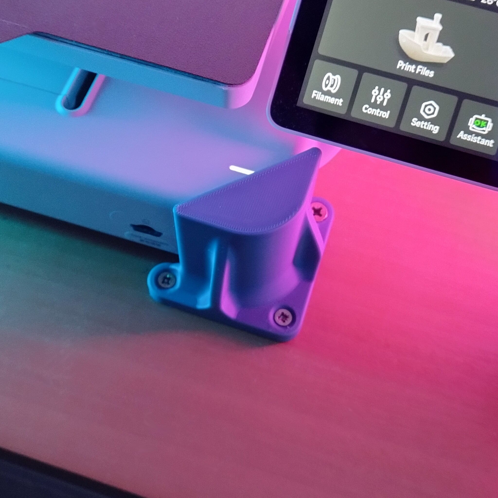
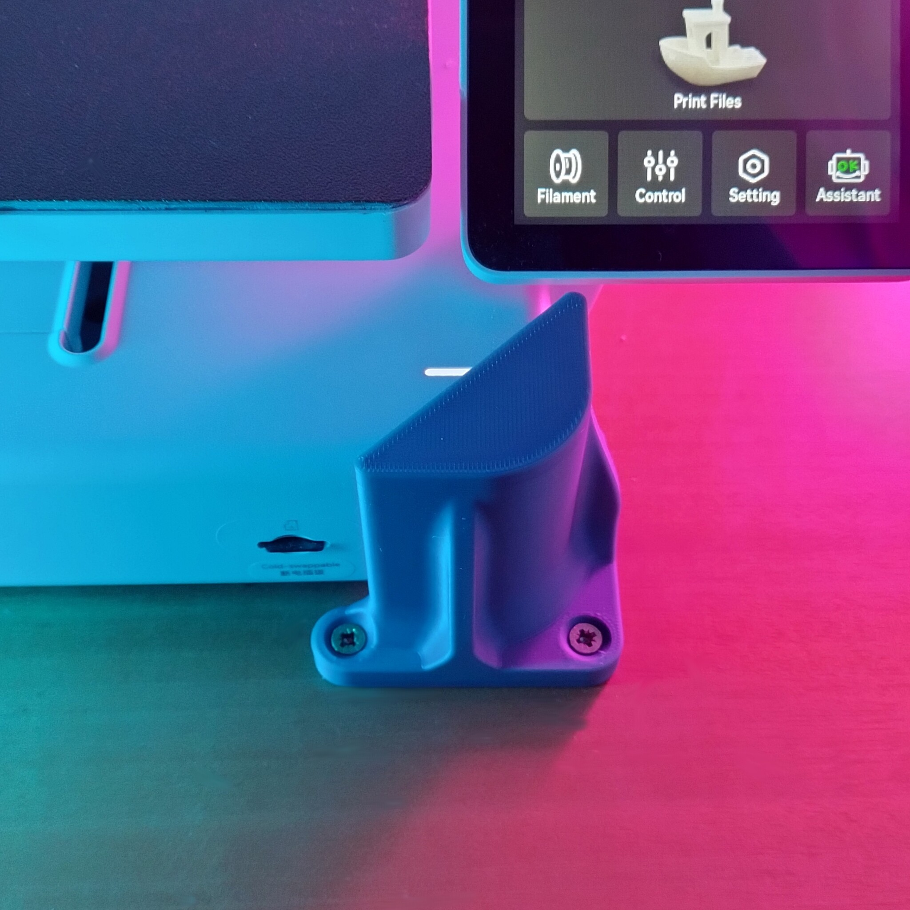
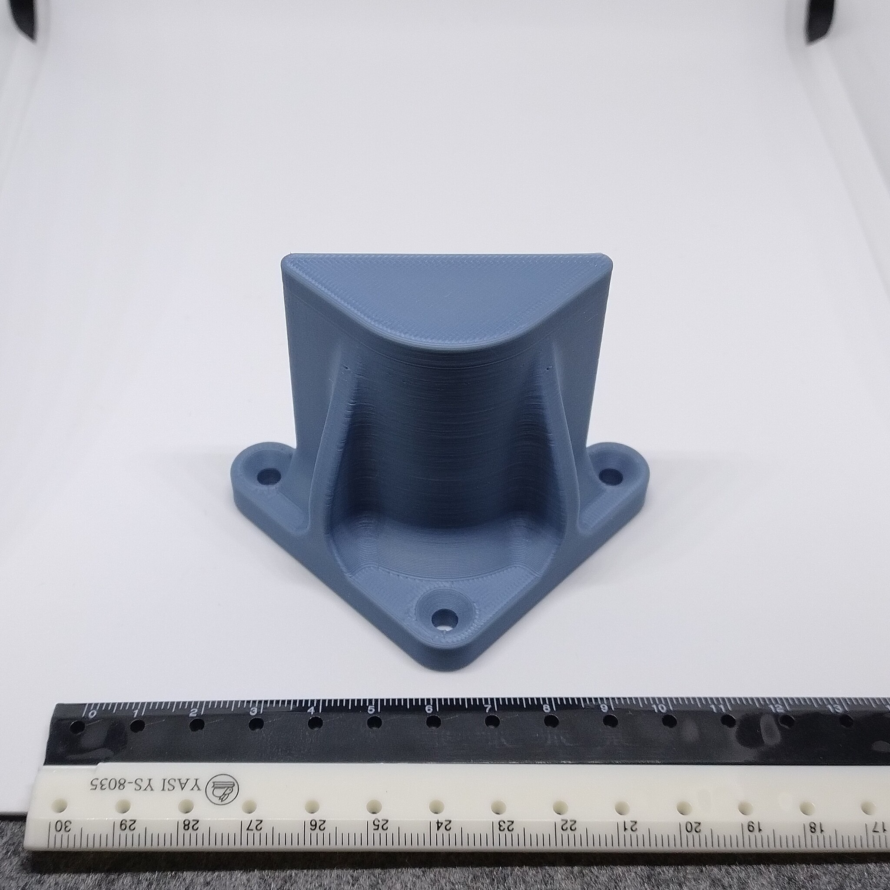
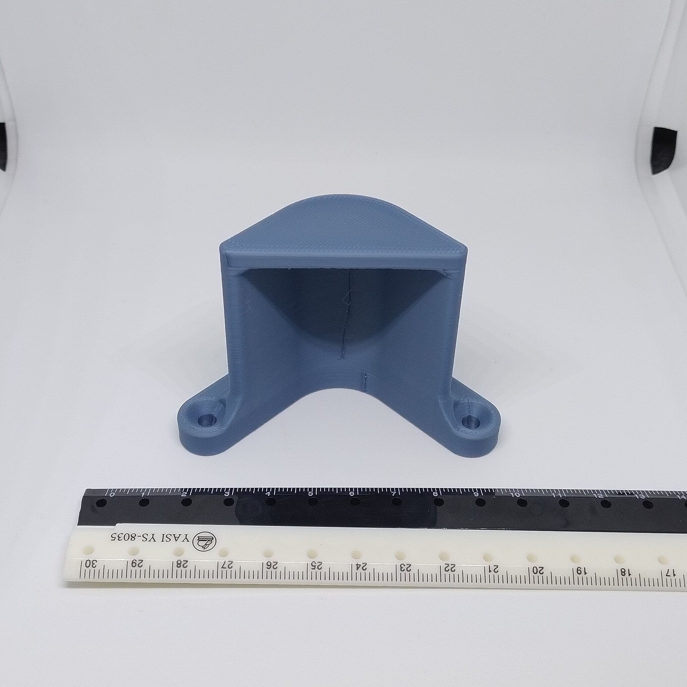

# Bambulab A1 screwdown holder

- **Brief**: Four-corner clamp set for fastening a Bambu Lab A1 printer to a solid surface.
- **Tags**: `Bambu Lab A1`, `3d-printer`, `mount`, `clamp`, `screwdown`.
- **Published**:
  [Thingiverse](https://www.thingiverse.com/thing:7425066),
  [Printables](https://www.printables.com/model/1885202-bambulab-a1-screwdown-holder),
  [MakerWorld](https://makerworld.com/en/models/3471201-bambulab-a1-screwdown-holder),
  [Cults3D](https://cults3d.com/en/3d-model/tool/bambulab-a1-screwdown-holder-zeroex-2).

These corner holders secure a Bambu Lab A1 to a rigid surface with screws. They help keep the printer in place where movement or vibration is a concern, including vehicle installations.

The set has three matching holders and one distinct back-left holder with a cutout for the printer's power button.

<!------------------------------------------------------------------------------------------------->
## Instructions
<!------------------------------------------------------------------------------------------------->

### Bill of materials

- 12 screws, up to 5 mm in diameter.

### Printing

- Use sturdy print settings because the holders may be exposed to vibration (e.g., 3 walls and 15% infill).
- Supports are recommended; automatic tree supports have worked well.

### Assembly

1. Print `1. x3 fr fl br.stl` three times. These are the front-left, front-right, and back-right holders.
2. Print `2. x1 bl.stl` once. This is the back-left holder with a cutout for the power button.
3. Place the holders neatly around your Bambu Lab A1 printer, on the surface to which you want to fasten it.
4. Optionally, mark the holes and predrill.
5. Screw the holders down. Don't fully tighten one screw at a time; instead, tighten the screws in turns to keep the printer level and distribute the pressure evenly.
6. Profit.

<!------------------------------------------------------------------------------------------------->
## Attribution
<!------------------------------------------------------------------------------------------------->

This is an original 3D print model.

Explore my [3D print model collection](https://zeroexgit.github.io/3d-print-models/) to discover more models and check for updates to this one.

<!------------------------------------------------------------------------------------------------->
## License
<!------------------------------------------------------------------------------------------------->

This model is licensed under [**CC BY-NC-SA 4.0**](https://creativecommons.org/licenses/by-nc-sa/4.0/).
