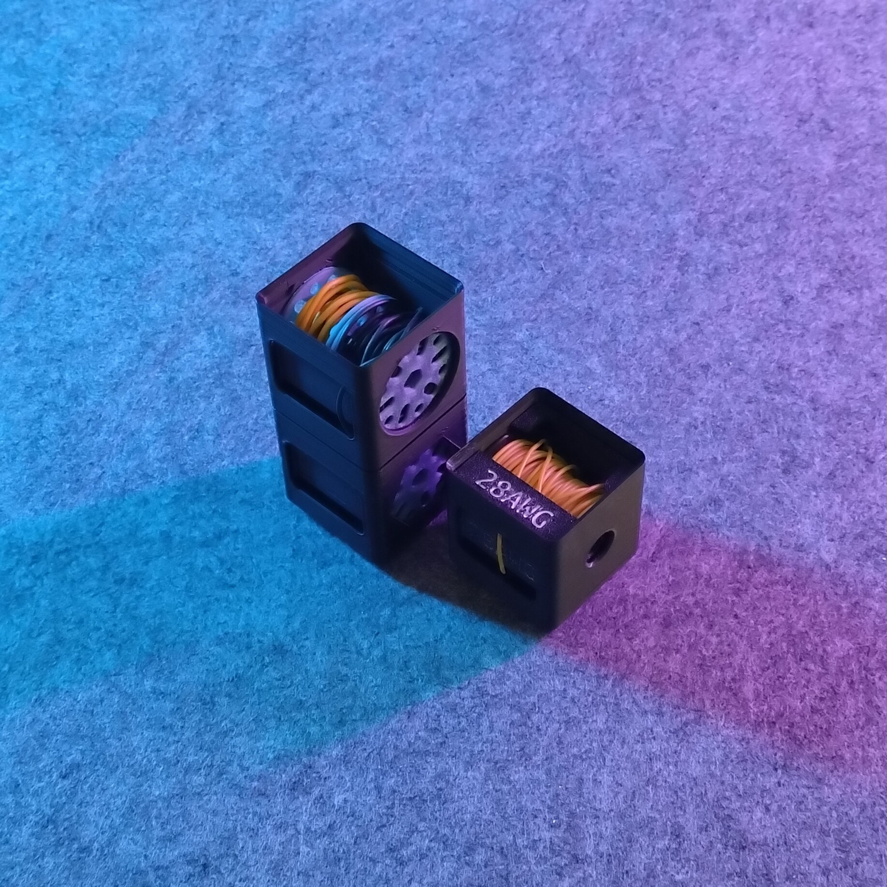
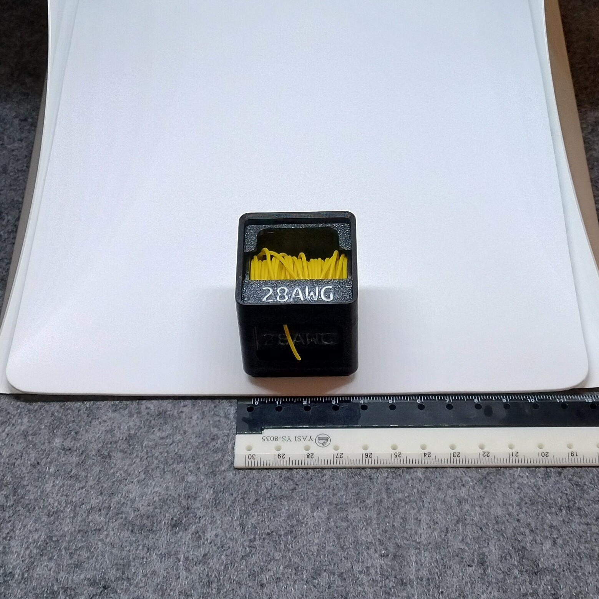
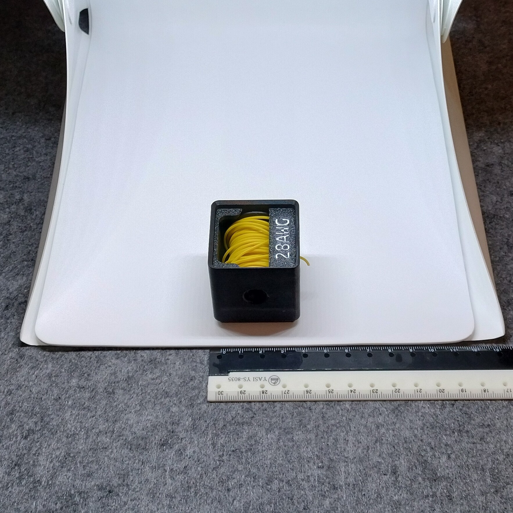

# Gridfinity - Bin 1.1.6 - Wire spool holder

- **Brief**: Gridfinity bin for cable and electronic wires.
- **Tags**: `gridfinity`, `storage`, `tools`, `wires`, `spoolholder`.
- **Published**:
  [Thingiverse](https://www.thingiverse.com/thing:7423489),
  [Printables](https://www.printables.com/model/1880854-gridfinity-bin-116-wire-spool-holder),
  [MakerWorld](https://makerworld.com/en/models/3453605-gridfinity-bin-1-1-6-wire-spool-holder),
  [Cults3D](https://cults3d.com/en/3d-model/tool/gridfinity-bin-1-1-6-wire-spool-holder-zeroex).

Store one or two wire spools in this Gridfinity holder. Feed wire from the top in a Gridfinity drawer system or from the front with SKÅDIS or another panel mount. A small slit below the front window lets you pull the cable away from the window instead of letting it stick straight out, for a tidier setup. Choose the feed direction that fits your setup.

Labels retain the spools and identify the wire. Write on the labels or customize them with printed text naming the wire type. Each spool's winding core is kept as small as possible to maximize wire capacity.

Use a 6 mm or 1/4-inch hex bit to wind a spool. Drive the bit with a drill for faster winding. The design uses no bearings or sliding mechanism; its intended friction allows easy feeding while helping prevent accidental unspooling.

<!------------------------------------------------------------------------------------------------->
## Attribution
<!------------------------------------------------------------------------------------------------->

This is an original 3D print model.

Explore my [3D print model collection](https://zeroexgit.github.io/3d-print-models/) to discover more models and check for updates to this one.

<!------------------------------------------------------------------------------------------------->
## License
<!------------------------------------------------------------------------------------------------->

This model is licensed under [**CC BY-NC-SA 4.0**](https://creativecommons.org/licenses/by-nc-sa/4.0/).
