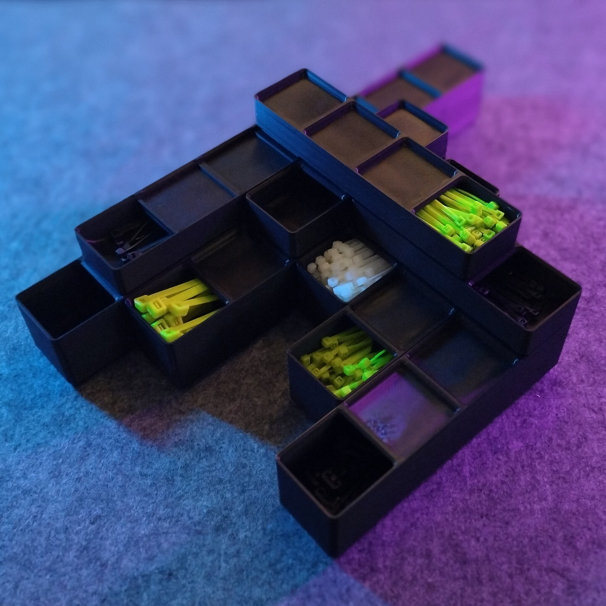
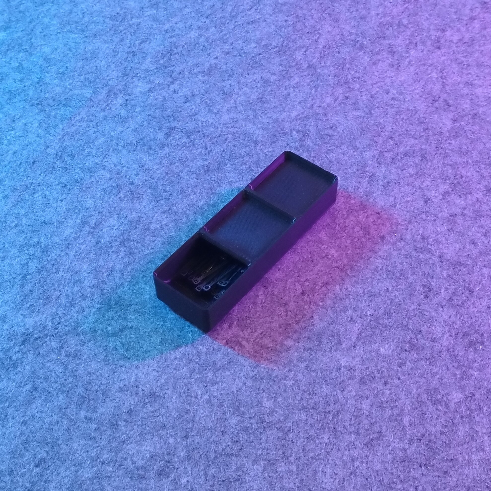
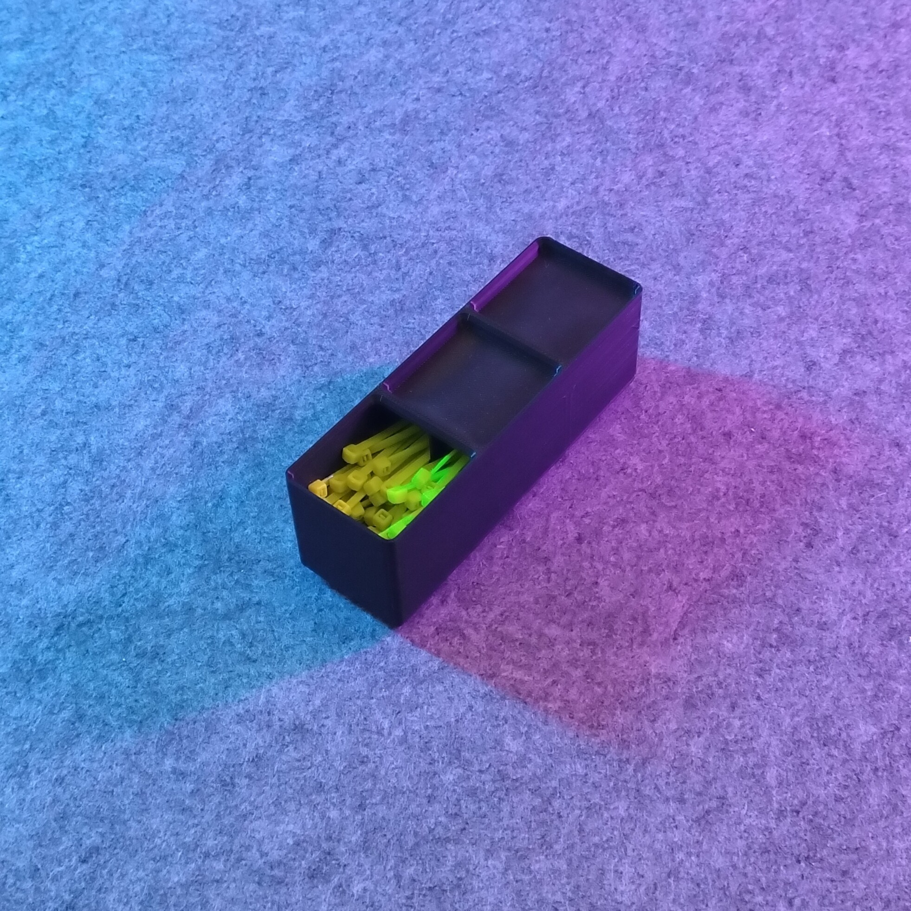
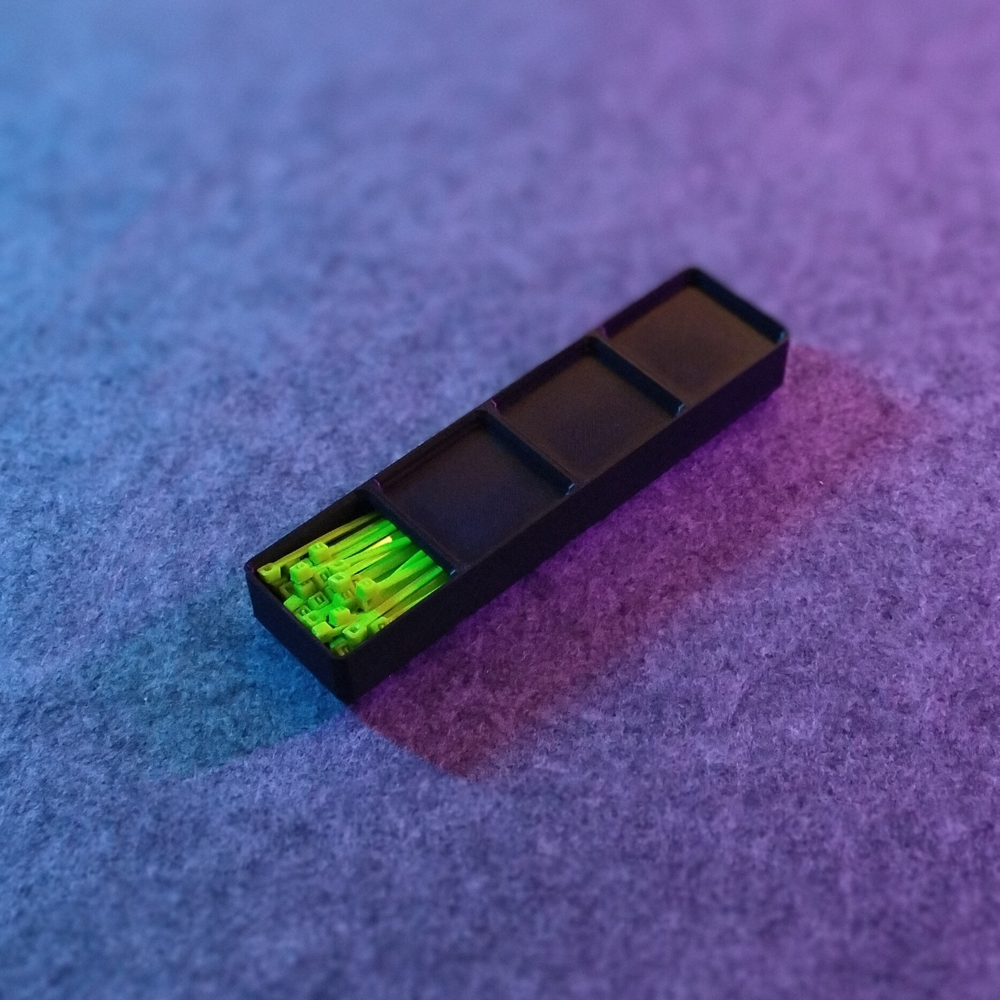
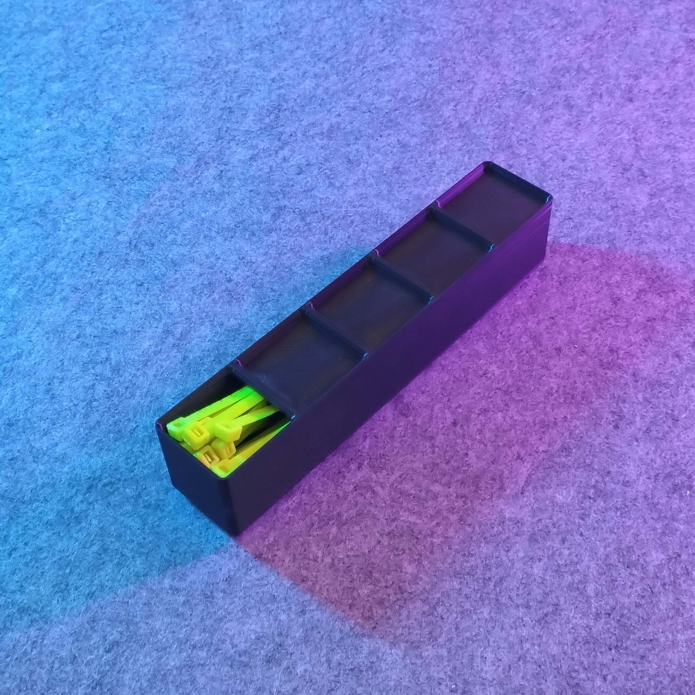

# Gridfinity - Bin 1.Y.Z - Stackable zipties

- **Brief**: Gridfinity bin for stackable zipties.
- **Tags**: `gridfinity`, `storage`, `tools`, `zipties`.
- **Published**:
  [Thingiverse](https://www.thingiverse.com/thing:7423426),
  [Printables](https://www.printables.com/model/1880499-gridfinity-bin-1yz-stackable-zipties),
  [MakerWorld](https://makerworld.com/en/models/3452820-gridfinity-bin-1-y-z-stackable-zipties),
  [Cults3D](https://cults3d.com/en/3d-model/tool/gridfinity-bin-1-y-z-stackable-zipties-zeroex).

Store zip ties horizontally in these fully enclosed Gridfinity bins. The enclosure keeps ties from falling out and from interfering with stacked bins. A finger slide provides access to the ties.

The included bins are 3 or 6 vertical units tall and range from 2 to 8 grid units long. For longer bins, the project also includes building blocks that let you assemble custom lengths.

A central separator supports the top during printing to help prevent sagging on most printers. It also keeps different colors or types of zipties organized in the same bin without mixing.

<!------------------------------------------------------------------------------------------------->
## Attribution
<!------------------------------------------------------------------------------------------------->

This is an original 3D print model.

Explore my [3D print model collection](https://zeroexgit.github.io/3d-print-models/) to discover more models and check for updates to this one.

<!------------------------------------------------------------------------------------------------->
## License
<!------------------------------------------------------------------------------------------------->

This model is licensed under [**CC BY-NC-SA 4.0**](https://creativecommons.org/licenses/by-nc-sa/4.0/).
