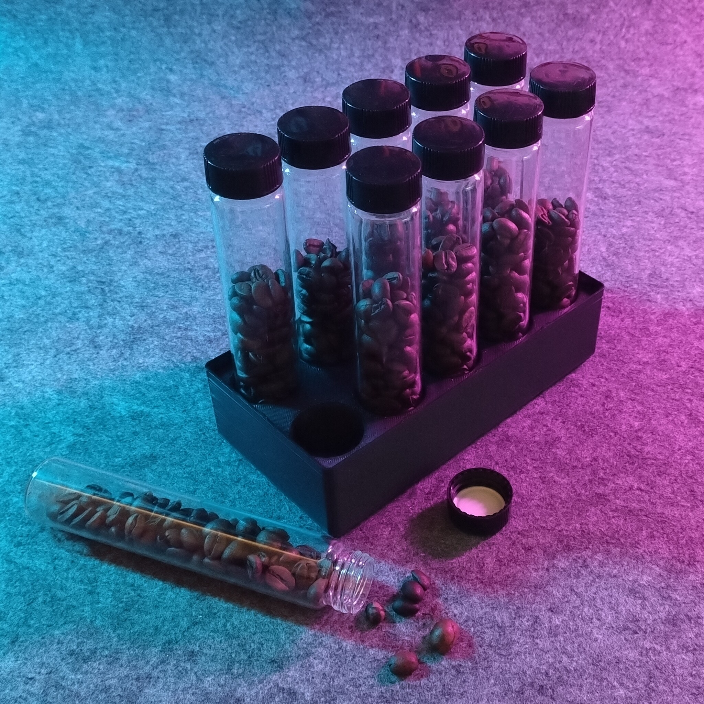
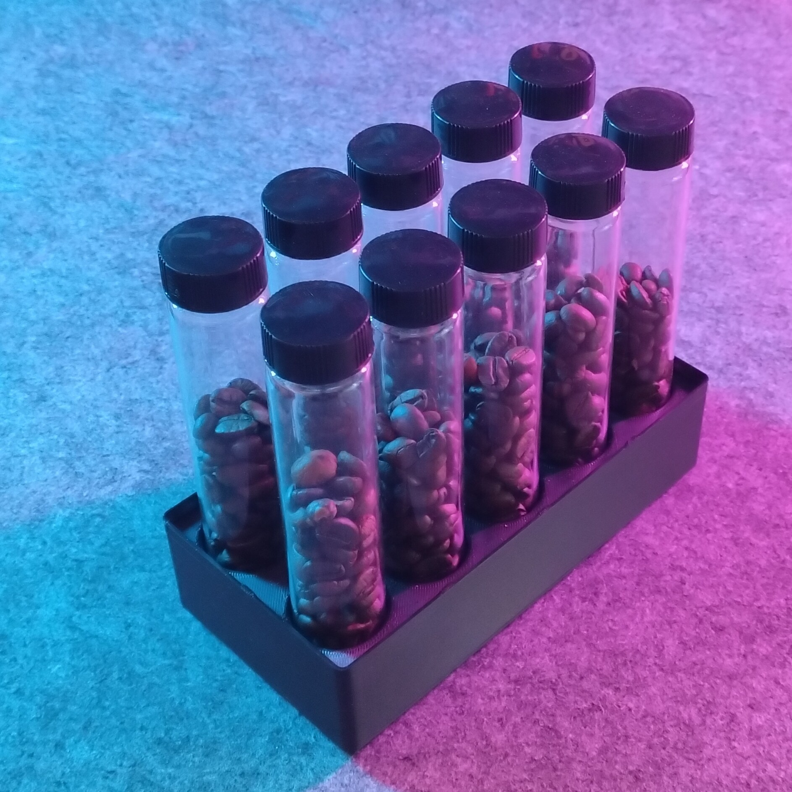
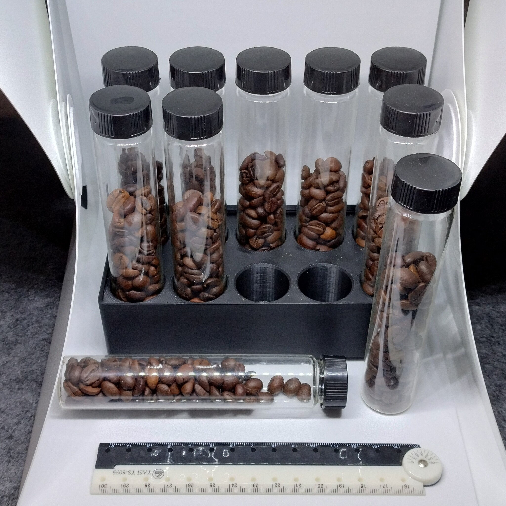
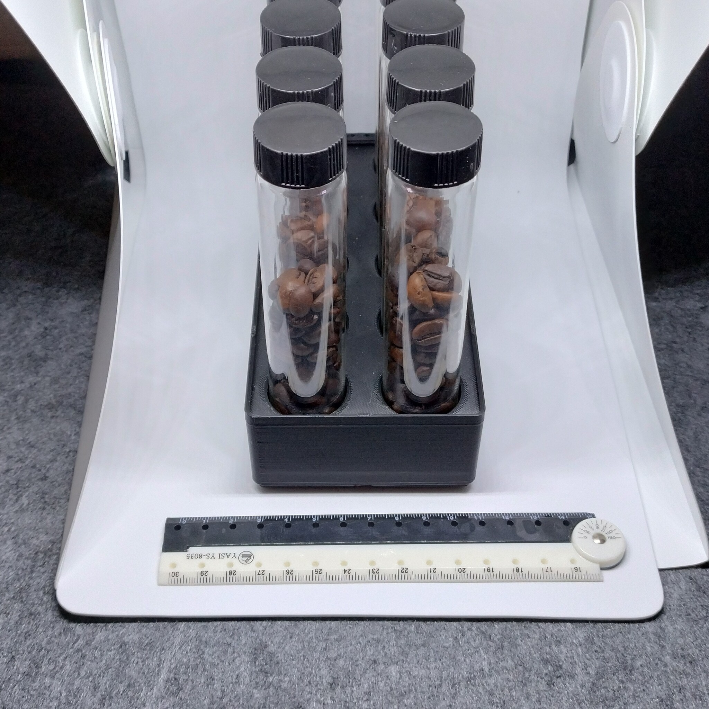

# Gridfinity - Bin 2.4.6 - Coffee bean test tube holder (remix)

- **Brief**: Gridfinity bin with eight holes for 27 mm glass vials to store coffee beans ready to grind.
- **Tags**: `gridfinity`, `coffee`, `vial holder`, `kitchen`.
- **Published**:
  [Thingiverse](https://www.thingiverse.com/thing:7425223),
  [Printables](https://www.printables.com/model/1885928-gridfinity-bin-246-coffee-bean-test-tube-holder-re),
  [MakerWorld](https://makerworld.com/en/models/3473821-gridfinity-bin-2-4-6-coffee-bean-tubes-remix),
  [Cults3D](https://cults3d.com/en/3d-model/home/gridfinity-bin-2-4-6-coffee-bean-test-tube-holder-remix).

This 2x4x6 Gridfinity bin holds eight 27 mm glass vials of coffee beans, spaced for easy access. The bin stacks when empty but not with vials installed. If the vials fit loosely, apply fuzzy skin to the inner surfaces of the holes to add grip.

<!------------------------------------------------------------------------------------------------->
## Attribution
<!------------------------------------------------------------------------------------------------->

This model is a remix of a 3D print model by **kennetek** obtained from <https://www.printables.com/model/274917-gridfinity-rebuilt-in-openscad>.

Explore my [3D print model collection](https://zeroexgit.github.io/3d-print-models/) to discover more models and check for updates to this one.

### Differences of the remix compared to the original

- Configured as a 2x4x6 bin with eight holes for 27 mm vials.
- Simplified the base around its 6x2 mm press-fit magnet holes.
- Added lip notches for easier stacking.

<!------------------------------------------------------------------------------------------------->
## License
<!------------------------------------------------------------------------------------------------->

This model is licensed under [**CC BY-SA 4.0**](https://creativecommons.org/licenses/by-sa/4.0/).
