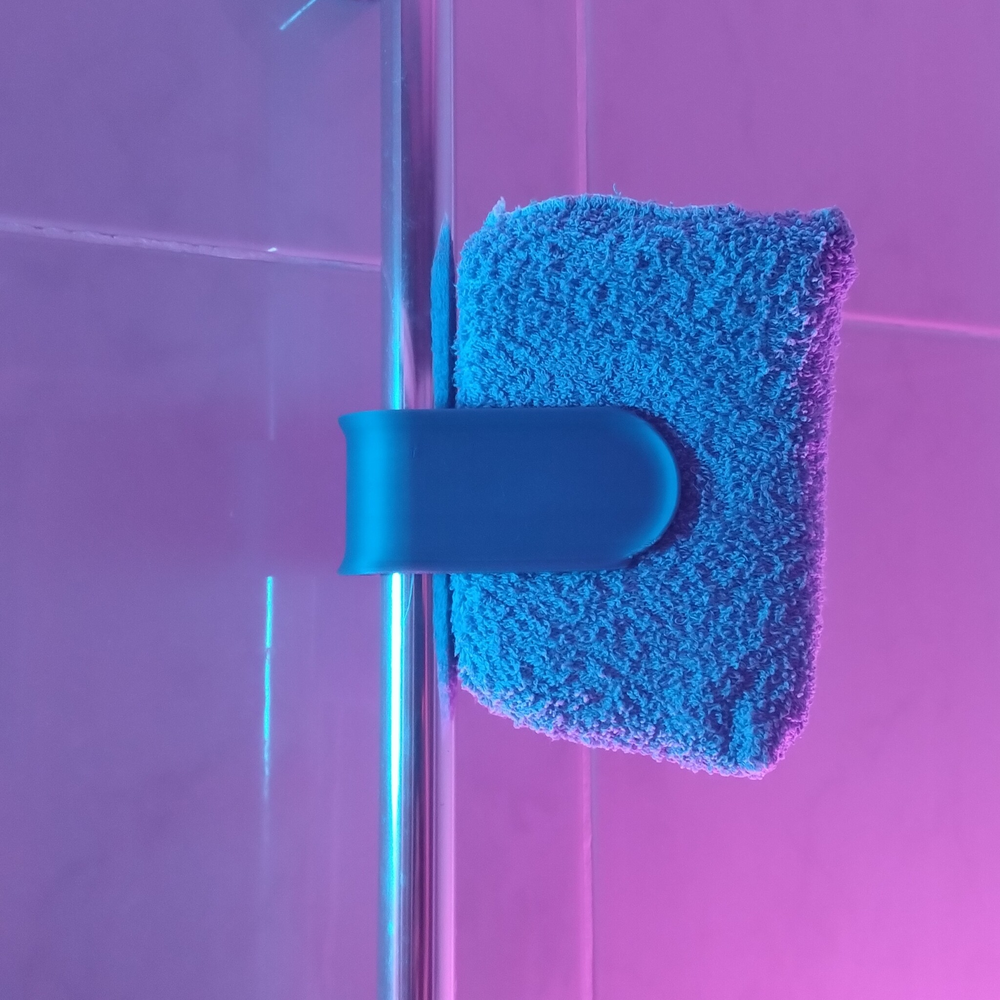
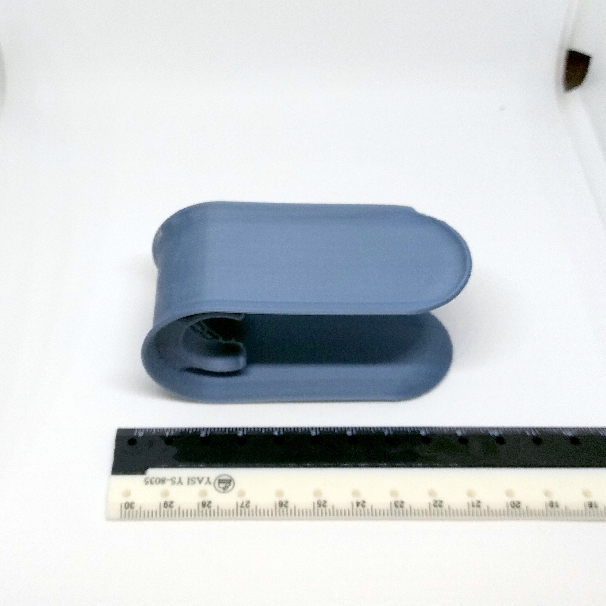
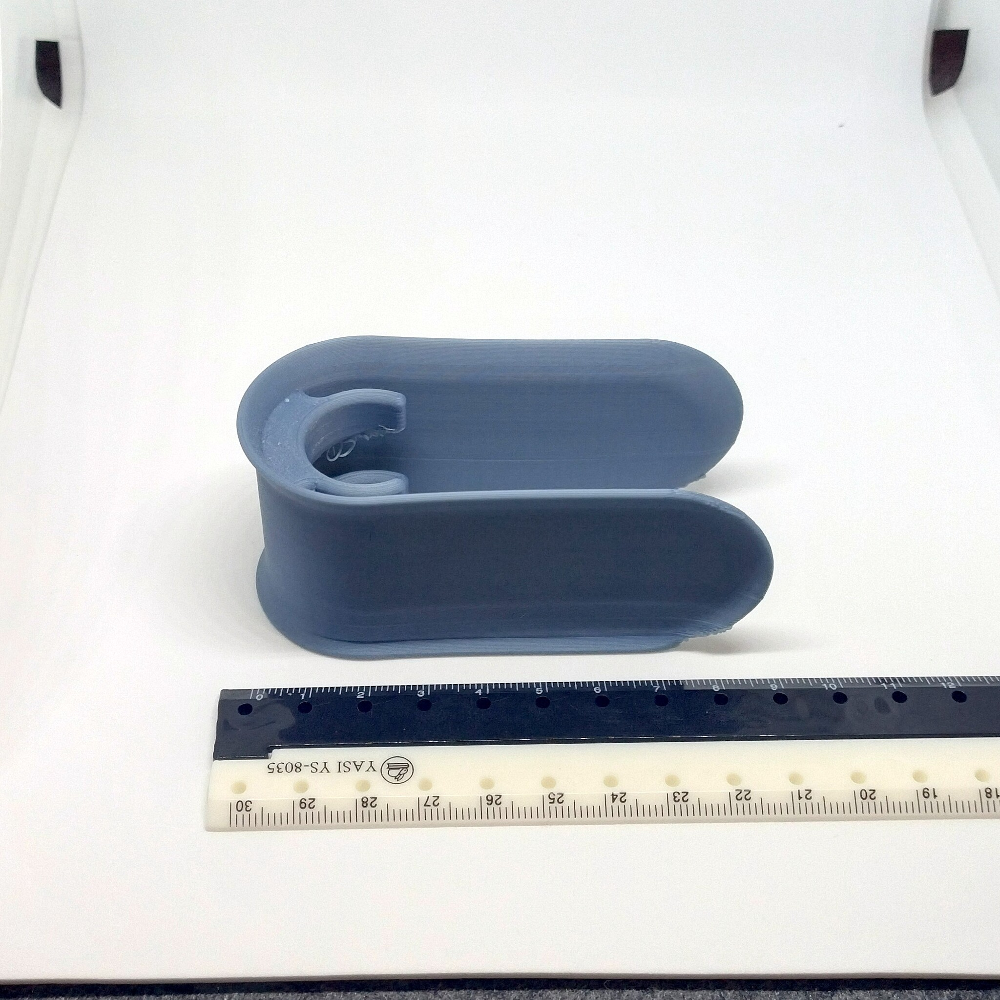

# 20 mm shower bar large sponge holder (remix)

- **Brief**: Sponge holder sized for 20 mm shower bars.
- **Tags**: `sponge`, `shower`, `shower-bar`, `remix`.
- **Published**:
  [Thingiverse](https://www.thingiverse.com/thing:7425978),
  [Printables](https://www.printables.com/model/1887719-20-mm-shower-bar-large-sponge-holder-remix),
  [MakerWorld](https://makerworld.com/en/models/3481428-20-mm-shower-bar-large-sponge-holder-remix),
  [Cults3D](https://cults3d.com/en/3d-model/home/20-mm-shower-bar-large-sponge-holder-remix).

This is a modified sponge holder, remixed to hold larger and thus heavier (when wet) sponges on 20 mm shower bars.

<!------------------------------------------------------------------------------------------------->
## Attribution
<!------------------------------------------------------------------------------------------------->

This model is a remix of a 3D print model by **Jakub K** obtained from
<https://www.printables.com/model/1496178-shower-sponge-holder>.

Explore my [3D print model collection](https://zeroexgit.github.io/3d-print-models/) to discover more models and check for updates to this one.

### Differences of the remix compared to the original

- Lengthened the holder for larger sponges.
- Pre-compressed the holder to increase its grip on heavier sponges and partly offset plastic creep.
- Applied these changes only to the 20 mm version.

### Original Description

> It's a Shower Sponge Holder.
>
> It clips onto your shower riser rail and you slot the sponge into it. Water drains from the sponge straight to the shower tray which means it doesn't sit in the water on a shelve somewhere and doesn't get manky.
>
> If , like me, you have a rain head and the pipe that goes to it has a little connecting bit , you can use the same size of a holder as the thickness of a pipe. Just slot the connector in a gap in a print and it'll spin on a rail freely but not come down. If you don't have it, use a holder with a  smaller diameter than the pipe's diameter for a nice tight snap fit

<!------------------------------------------------------------------------------------------------->
## License
<!------------------------------------------------------------------------------------------------->

This model is licensed under [**CC BY-NC-SA 4.0**](https://creativecommons.org/licenses/by-nc-sa/4.0/).
