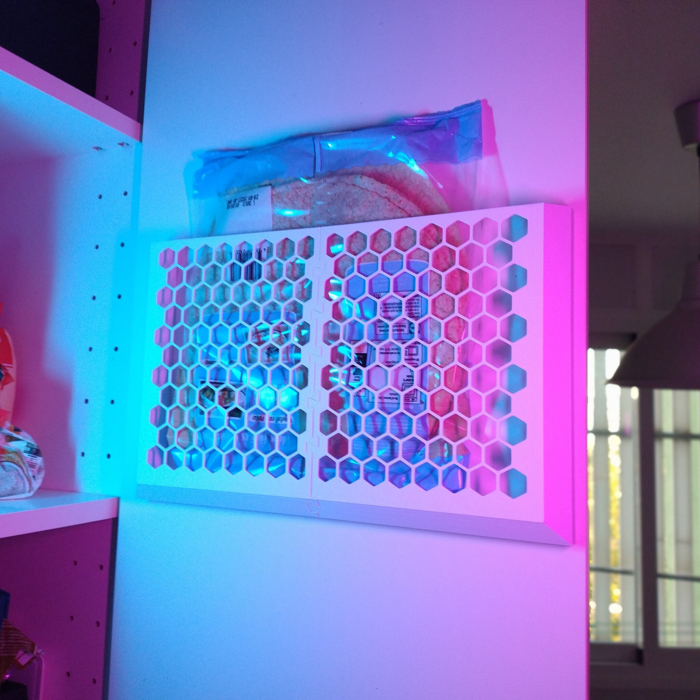
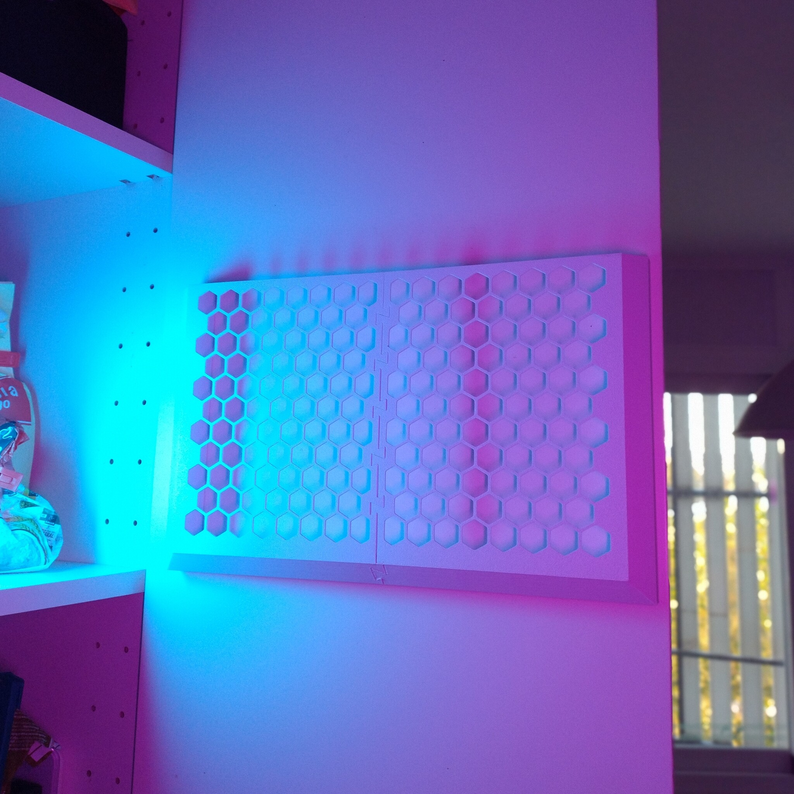
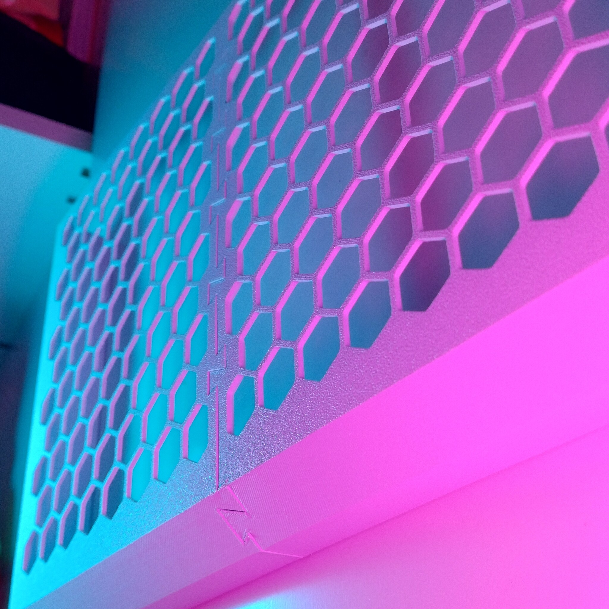

# Kitchen door tortilla holder shelf

- **Brief**: Wall-mounted holder that stores large tortillas upright to save cabinet space.
- **Tags**: `tortilla`, `kitchen`, `storage`, `holder`.
- **Published**:
  [Thingiverse](https://www.thingiverse.com/thing:7425211),
  [Printables](https://www.printables.com/model/1885881-kitchen-door-tortilla-holder-shelf),
  [MakerWorld](https://makerworld.com/en/models/3473605-kitchen-door-tortilla-holder-shelf),
  [Cults3D](https://cults3d.com/en/3d-model/home/kitchen-door-tortilla-holder-shelf).

Large tortillas take up cabinet space. This holder mounts to a cabinet door or side wall with double-sided tape and stores tortillas upright. It can also store various items, including cleaning supplies. The assembled holder is approximately 370 mm wide, 220 mm tall, and 30 mm deep.

The model includes small sacrificial helpers that avoid the need for supports. It requires a print bed of approximately 220 x 185 mm. Glue the dovetail cover strip in place with cyanoacrylate or similar adhesive; the dovetail may otherwise become a point of failure.

<!------------------------------------------------------------------------------------------------->
## Instructions
<!------------------------------------------------------------------------------------------------->

### Bill of materials

- Cyanoacrylate glue or similar
- Double-sided adhesive tape

### Printing

- No supports are needed; built-in temporary supports are included to help with printing.
- Enable elephant-foot compensation and other precision-printing settings to help the dovetail joint fit. If needed, deburr or lightly sand the joint.

### Assembly

1. Print the parts.
2. Break away the temporary supports.
3. Assemble the two large pieces. Deburr the joint if needed.
4. Reinforce the dovetail connection with glue, then cover it with the reinforcing strip.
5. Apply pieces of double-sided adhesive tape around the perimeter, then mount the holder on the kitchen cabinet door. Leave enough clearance to remove large objects from the top.

<!------------------------------------------------------------------------------------------------->
## Attribution
<!------------------------------------------------------------------------------------------------->

This is an original 3D print model.

Explore my [3D print model collection](https://zeroexgit.github.io/3d-print-models/) to discover more models and check for updates to this one.

<!------------------------------------------------------------------------------------------------->
## License
<!------------------------------------------------------------------------------------------------->

This model is licensed under [**CC BY-NC-SA 4.0**](https://creativecommons.org/licenses/by-nc-sa/4.0/).
