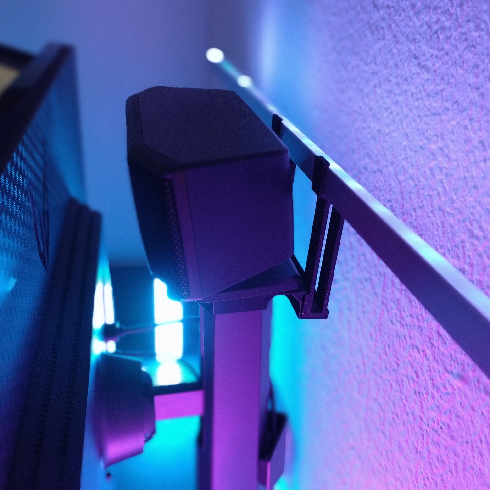
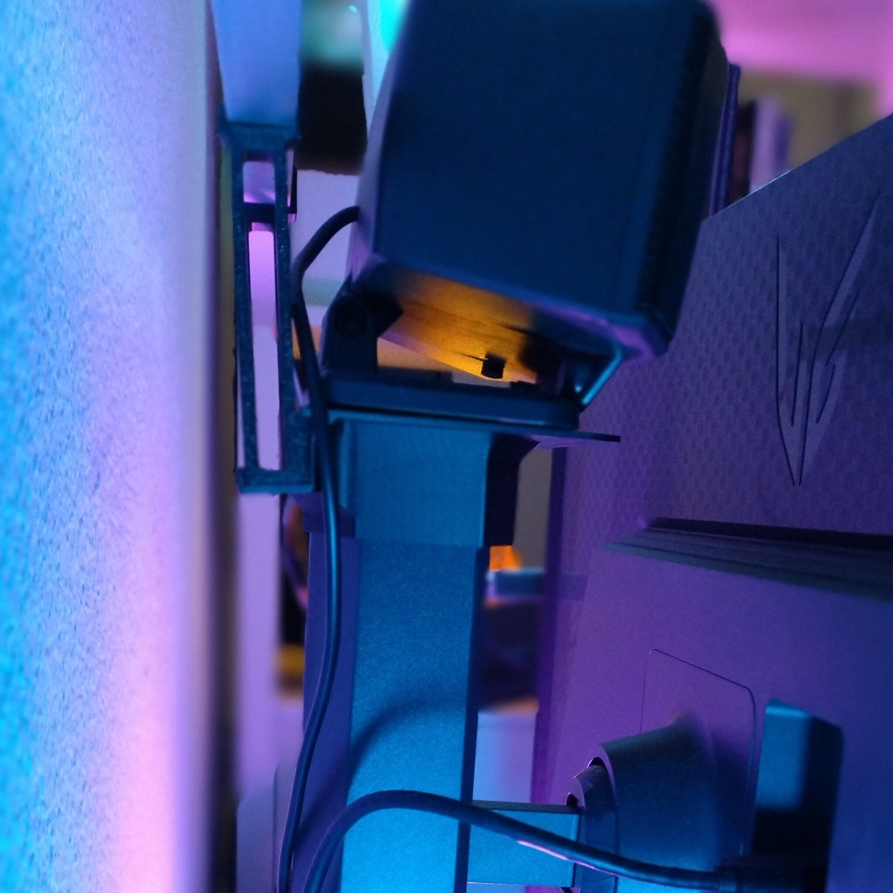
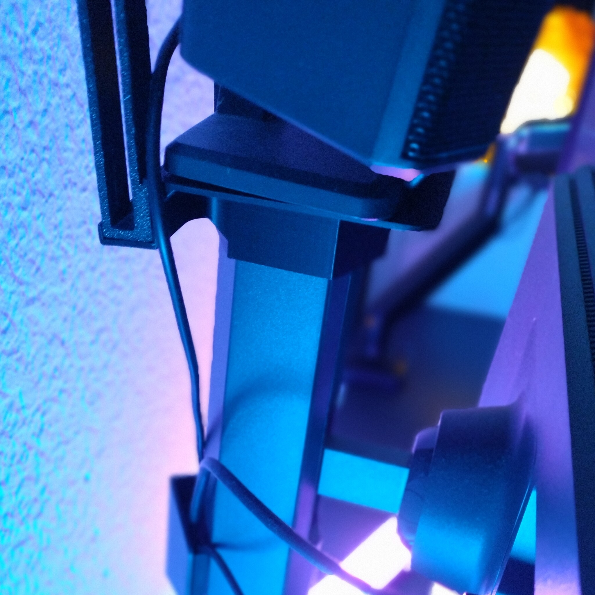
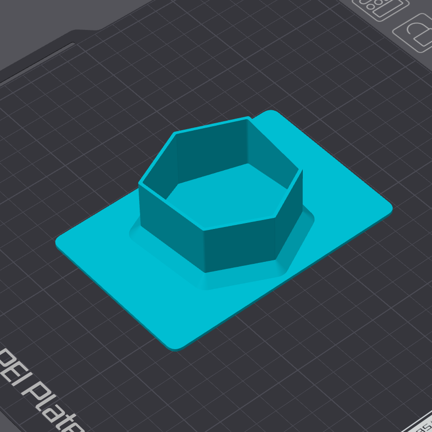
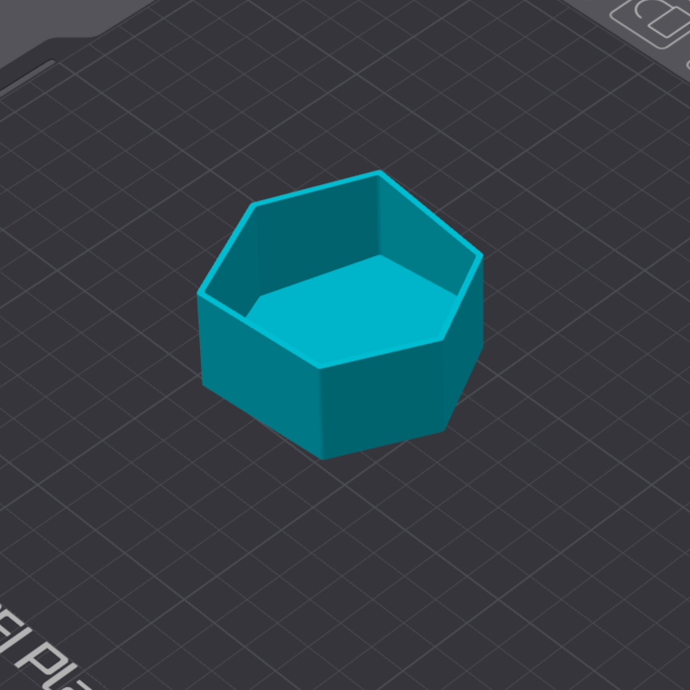

# LG UltraGear 32inch monitor tray

- **Brief**: Stand-mounted shelf for placing small items behind an LG UltraGear 32-inch monitor.
- **Tags**: `monitor`, `LG UltraGear`, `shelf`, `tray`.
- **Published**:
  [Thingiverse](https://www.thingiverse.com/thing:7425086),
  [Printables](https://www.printables.com/model/1885270-lg-ultragear-32inch-monitor-tray),
  [MakerWorld](https://makerworld.com/en/models/3471415-lg-ultragear-32inch-monitor-tray),
  [Cults3D](https://cults3d.com/en/3d-model/gadget/lg-ultragear-32inch-monitor-tray).

The tray fits over the end of the monitor stand and adds a shelf near the top edge of the screen. The shelf is 120 mm wide and 80 mm deep, with 5 mm rounded corners. I measured the stand by hand, so fit may vary. I use mine for a PC speaker and an LED stand.

The files include a version with the horizontal shelf and a base-only version for attaching a custom design in a remix.

<!------------------------------------------------------------------------------------------------->
## Attribution
<!------------------------------------------------------------------------------------------------->

This is an original 3D print model.

Explore my [3D print model collection](https://zeroexgit.github.io/3d-print-models/) to discover more models and check for updates to this one.

<!------------------------------------------------------------------------------------------------->
## License
<!------------------------------------------------------------------------------------------------->

This model is licensed under [**CC BY-NC-SA 4.0**](https://creativecommons.org/licenses/by-nc-sa/4.0/).
