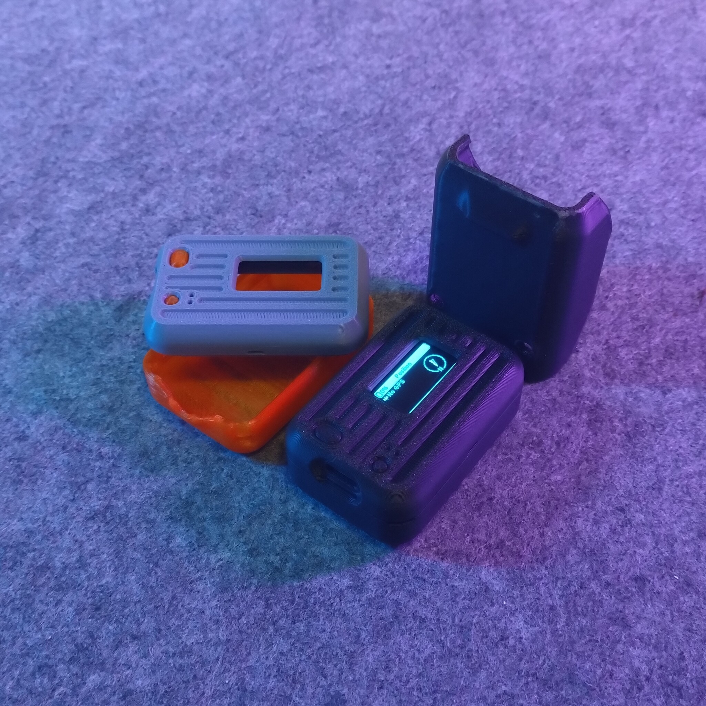
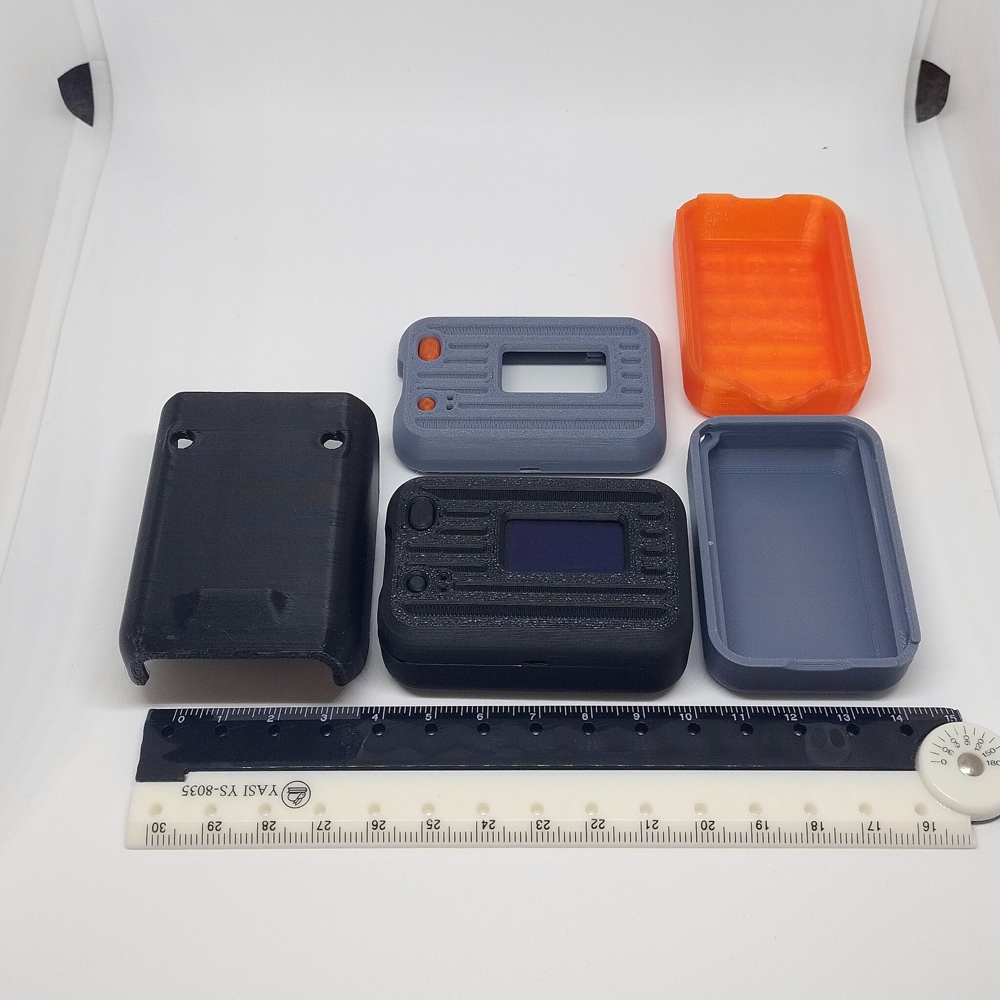
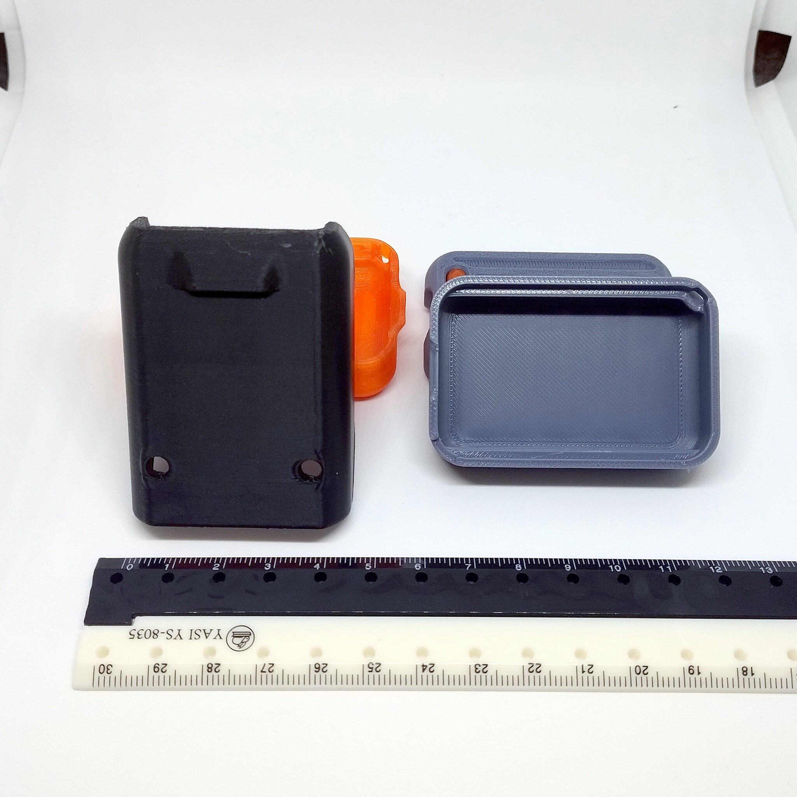

# Alley Cat Heltec LoRa32 V3 case without logo (remix)

- **Brief**: Logo-free Alley Cat case for the Heltec LoRa 32 V3.
- **Tags**: `Heltec`, `LoRa32`, `case`, `radio`, `remix`.
- **Published**:
  [Thingiverse](https://www.thingiverse.com/thing:7425964),
  [Printables](https://www.printables.com/model/1887706-alley-cat-heltec-lora32-v3-case-without-logo-remix),
  [MakerWorld](https://makerworld.com/en/models/3481151-alley-cat-heltec-v3-without-logo-remix),
  [Cults3D](https://cults3d.com/en/3d-model/gadget/alley-cat-heltec-lora32-v3-case-without-logo-remix).

This remix removes the 3D logo from the original case, leaving a blank surface. No other changes were made; this was a personal aesthetic choice. Refer to the original listing for assembly details.

<!------------------------------------------------------------------------------------------------->
## Attribution
<!------------------------------------------------------------------------------------------------->

This model is a remix of a 3D print model by **Alley Cat** obtained from <https://makerworld.com/en/models/589030-alley-chat-ht-pocket-heltec-lora-32-v3-case>.

Explore my [3D print model collection](https://zeroexgit.github.io/3d-print-models/) to discover more models and check for updates to this one.

### Differences of the remix compared to the original

- Removed 3D logo.

### Original Description

> Custom case for the Heltec LoRa 32 V3. No hardware needed unless you want to use the Baofeng style clip which requires M2.5 nuts or heat set inserts and M2.5x5mm screws. Here are links to the parts I used:

<!------------------------------------------------------------------------------------------------->
## License
<!------------------------------------------------------------------------------------------------->

This model is licensed under [**CC BY-SA 4.0**](https://creativecommons.org/licenses/by-sa/4.0/).
