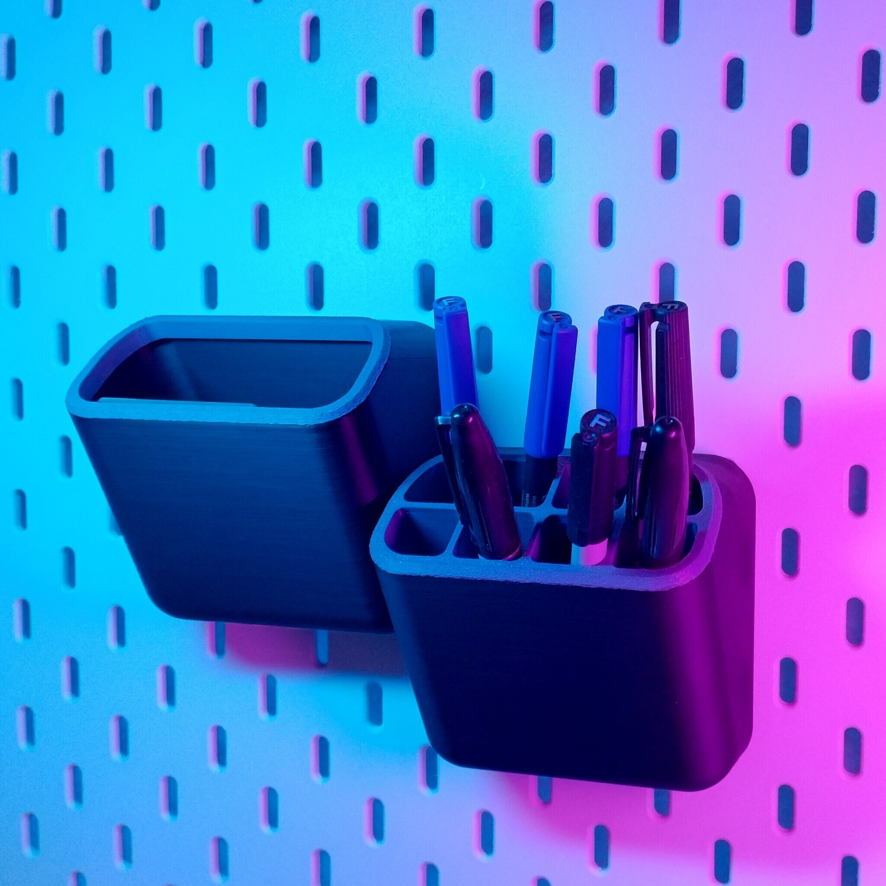
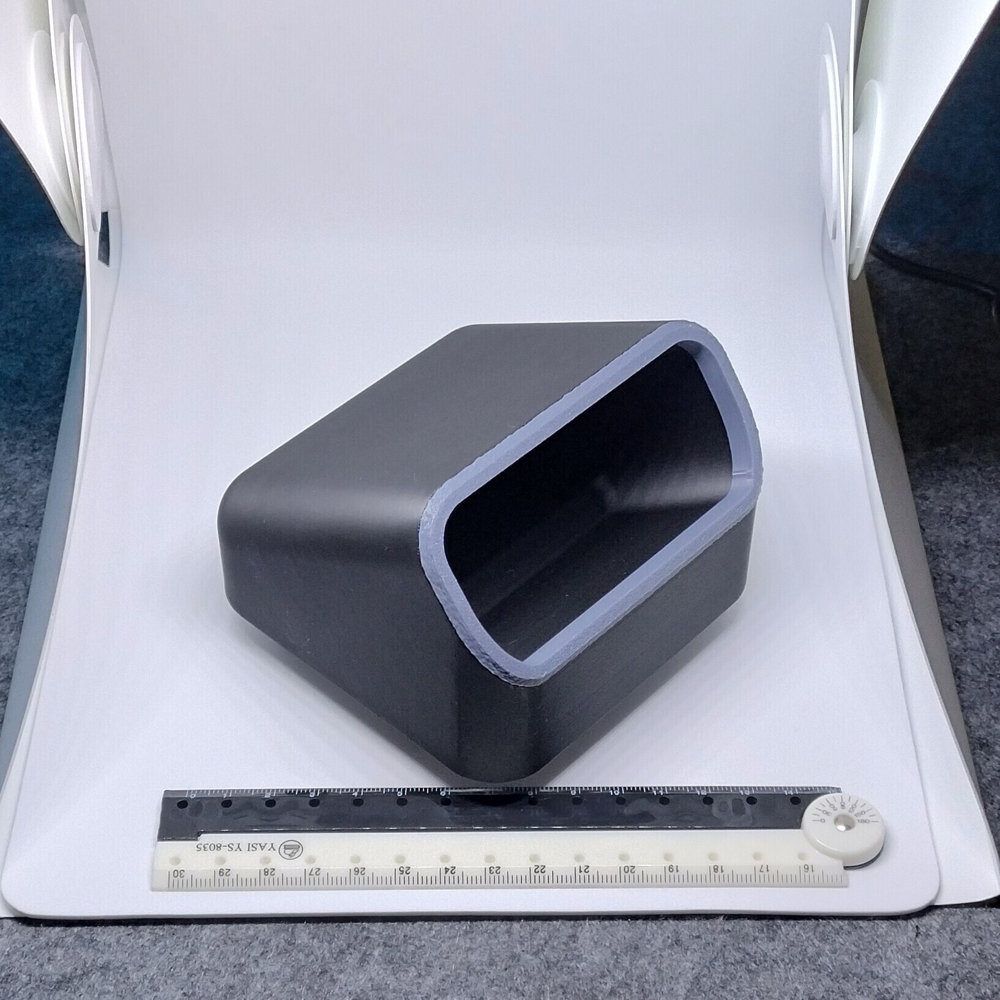
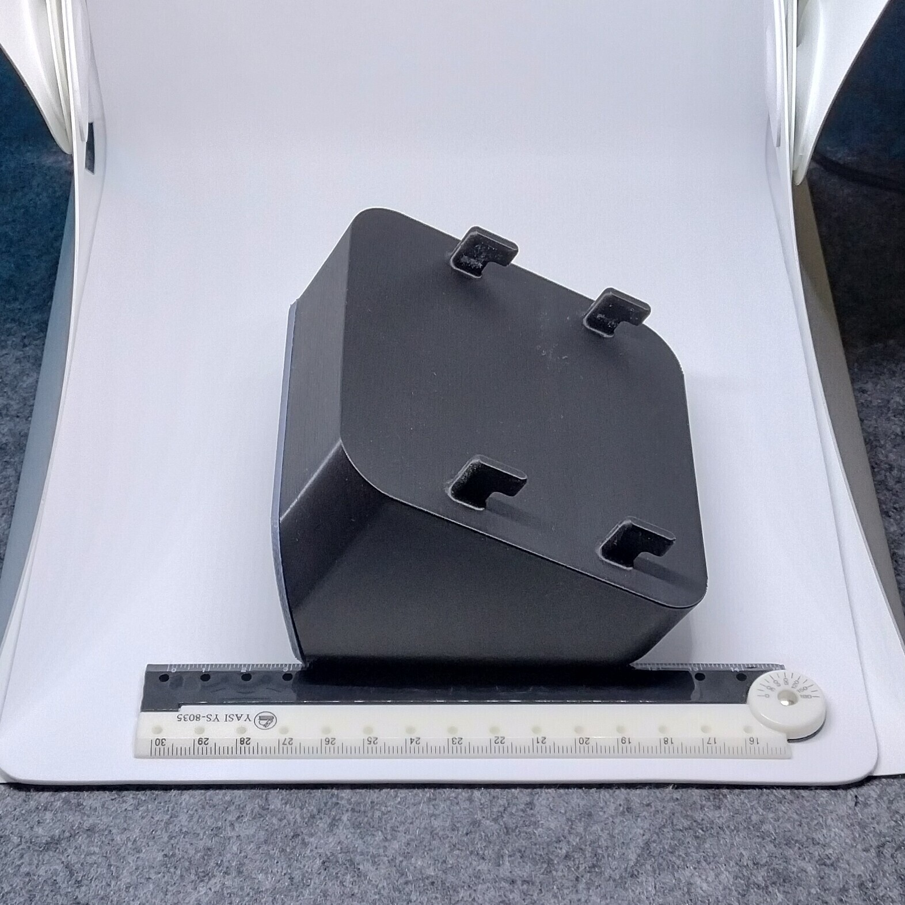

# Skadis - Bins and pen holder (proxy)

- **Brief**: Modular Skadis pockets, bins, and shelves with sturdy hangers.
- **Tags**: `Skadis`, `bins`, `shelves`, `storage`

<!------------------------------------------------------------------------------------------------->
## Attribution
<!------------------------------------------------------------------------------------------------->

This entry references a 3D print model by **SMACKMAX_** available at <https://www.printables.com/model/1114469-skadis-pockets-bins-tool-holder>.

Explore my [3D print model collection](https://zeroexgit.github.io/3d-print-models/) to discover more models and check for updates to this one.

### Original Description

> Here i present SKADIS Pockets / Bins / Shelves: Modular - No Support - Very sturdy hangers.
>
> Prints without support!
>
> Features:
> - Works in tandem with my (upcoming) stuff
> - Has sturdy mounting Points with large surface layer contact.
> - Type A & B need to be alternated for a full horizontal/vertical row (checker pattern)
> - Various inserts are avaible, but not needed.
> - Colour effects can be achieved without a multimaterial printer by introducing a manual layer switch and printing the inserts seperate. (mine is set about 55mm ish)

<!------------------------------------------------------------------------------------------------->
## License
<!------------------------------------------------------------------------------------------------->

This model is licensed under [**CC BY-NC-SA 4.0**](https://creativecommons.org/licenses/by-nc-sa/4.0/).
