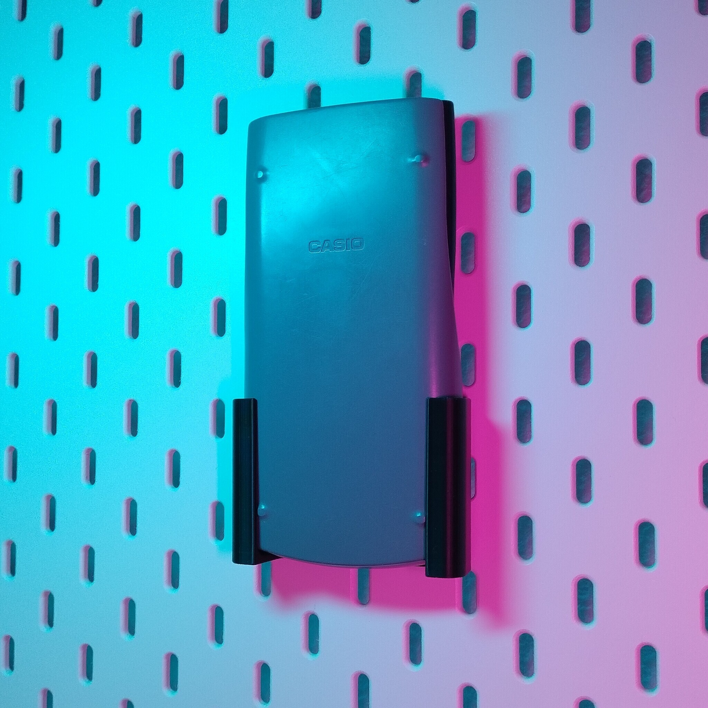
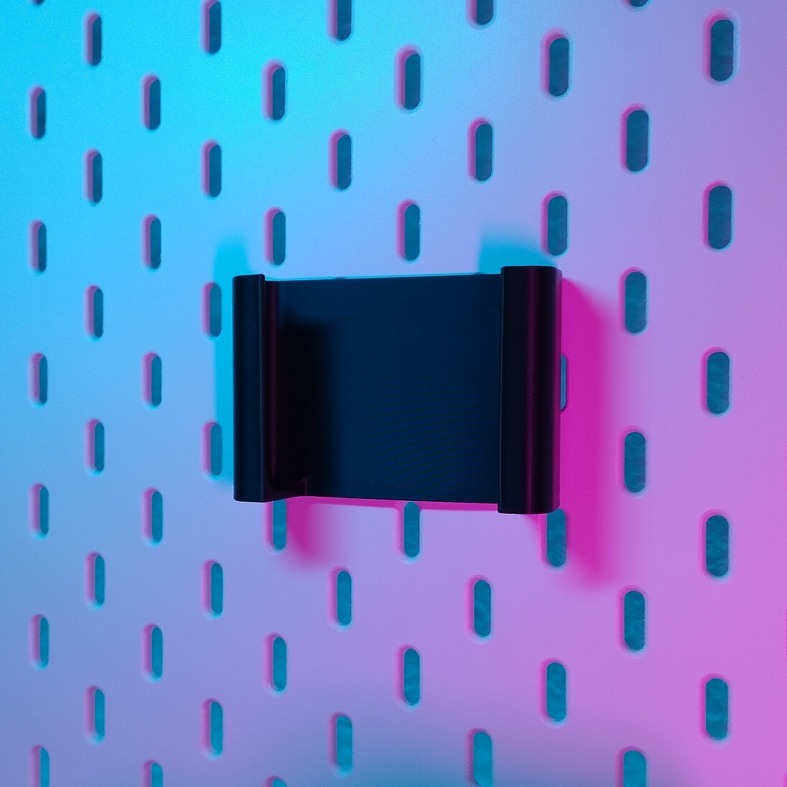
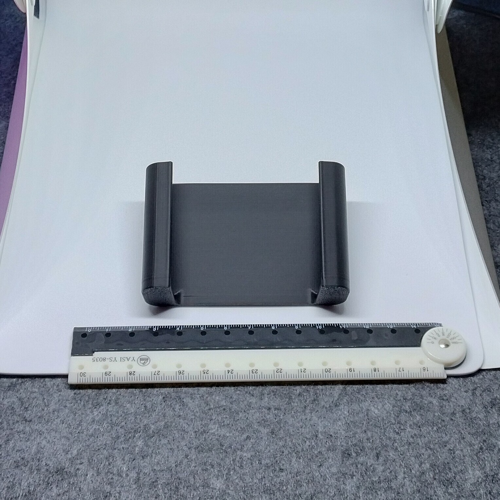
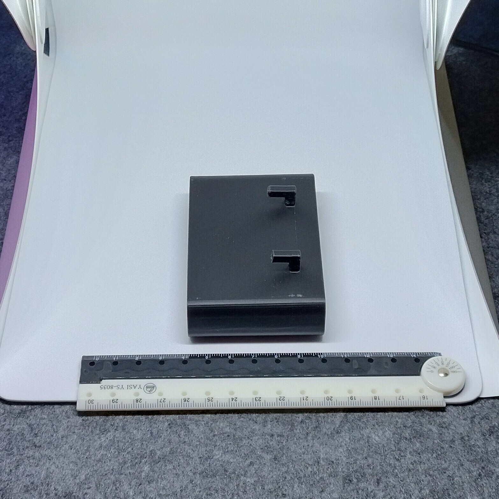

# Skadis - Casio calculator (proxy)

- **Brief**: Skadis-mounted bracket for a Casio fx-991 DE X calculator.
- **Tags**: `Skadis`, `calculator`, `holder`

<!------------------------------------------------------------------------------------------------->
## Attribution
<!------------------------------------------------------------------------------------------------->

This entry references a 3D print model by **Dominik DL2DE** available at <https://www.printables.com/model/548585-skadis-casio-fx-991>.

Explore my [3D print model collection](https://zeroexgit.github.io/3d-print-models/) to discover more models and check for updates to this one.

### Original Description

> IKEA Skadis bracket for Casio fx-991 DE X calculator.
>
> (Also fits my old Casio fx-85MS and probably many other models.)

<!------------------------------------------------------------------------------------------------->
## License
<!------------------------------------------------------------------------------------------------->

This model is licensed under [**CC BY-SA 4.0**](https://creativecommons.org/licenses/by-sa/4.0/).
