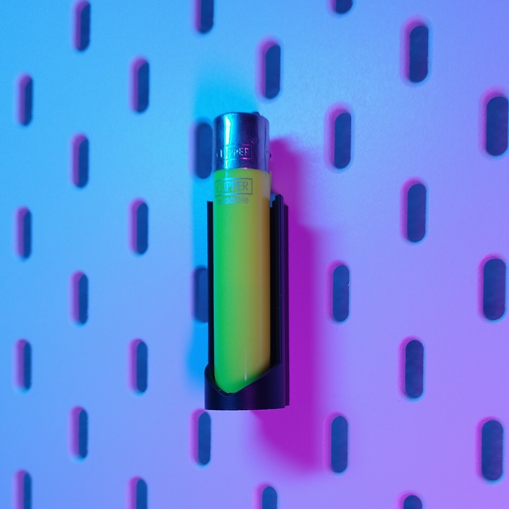
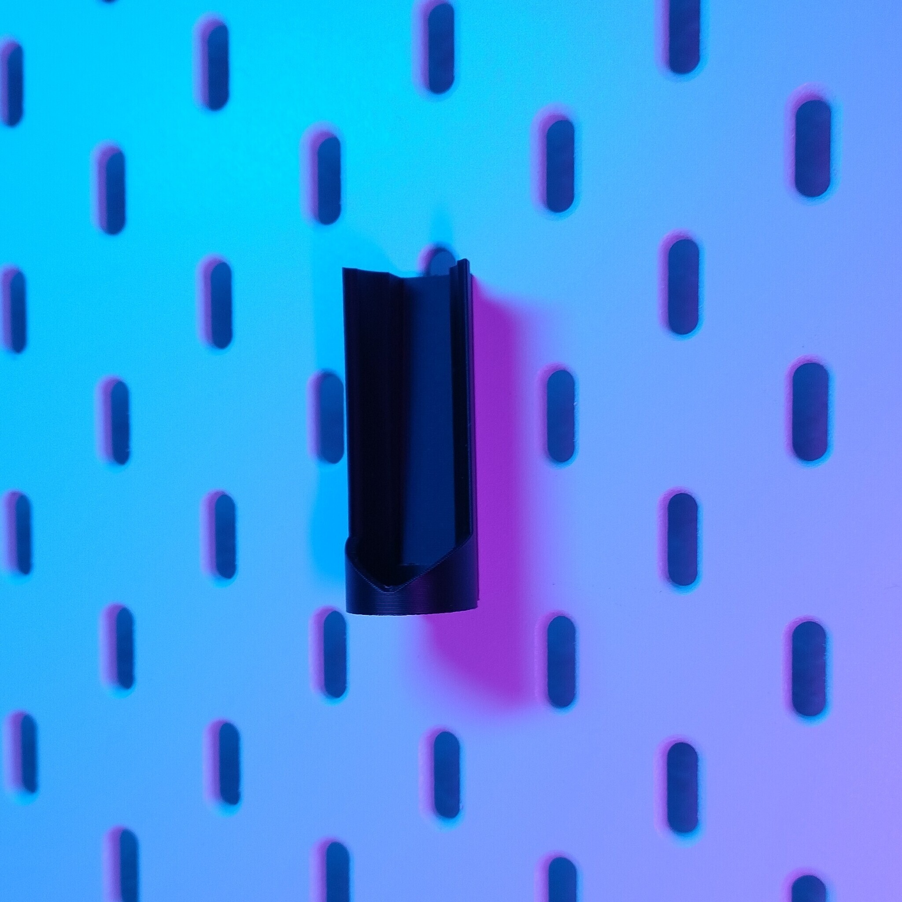
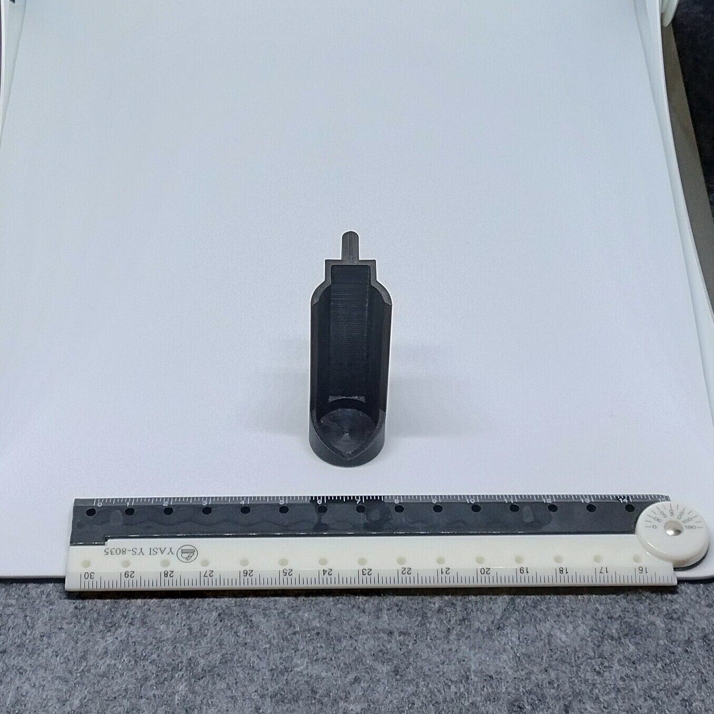
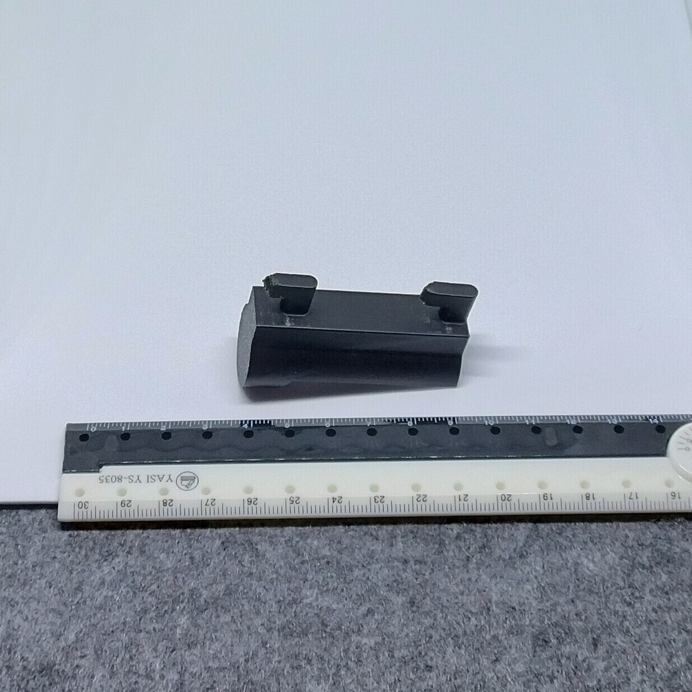

# Skadis - Clipper lighter (proxy)

- **Brief**: Wall mount for a Clipper lighter on an IKEA Skadis pegboard.
- **Tags**: `Skadis`, `Clipper lighter`, `holder`

<!------------------------------------------------------------------------------------------------->
## Attribution
<!------------------------------------------------------------------------------------------------->

This entry references a 3D print model by **Angel Roman** available at <https://www.printables.com/model/564490-skadis-clipper-lighter-holder>.

Explore my [3D print model collection](https://zeroexgit.github.io/3d-print-models/) to discover more models and check for updates to this one.

### Original Description

> Wall mount your CLIPPER Lighter to a IKEA SKÅDIS Pegboard.

<!------------------------------------------------------------------------------------------------->
## License
<!------------------------------------------------------------------------------------------------->

This model is licensed under [**CC BY-NC 4.0**](https://creativecommons.org/licenses/by-nc/4.0/).
