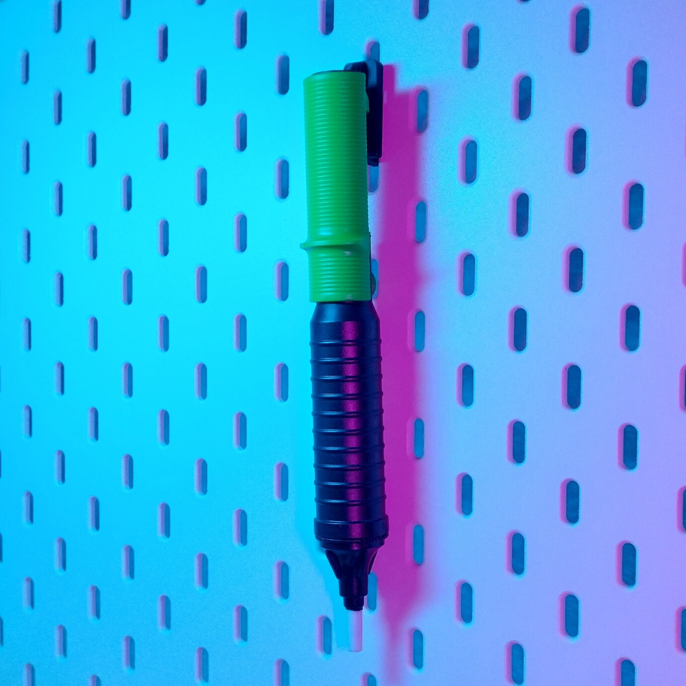
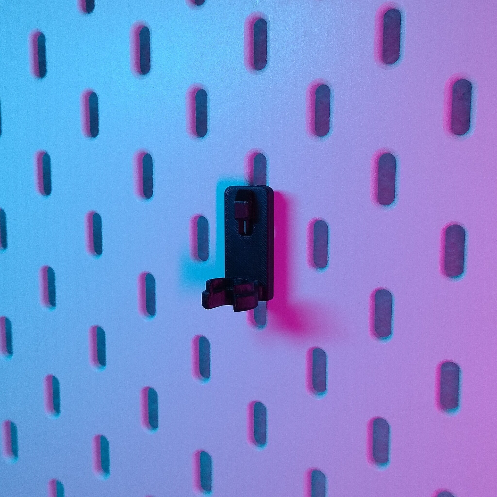
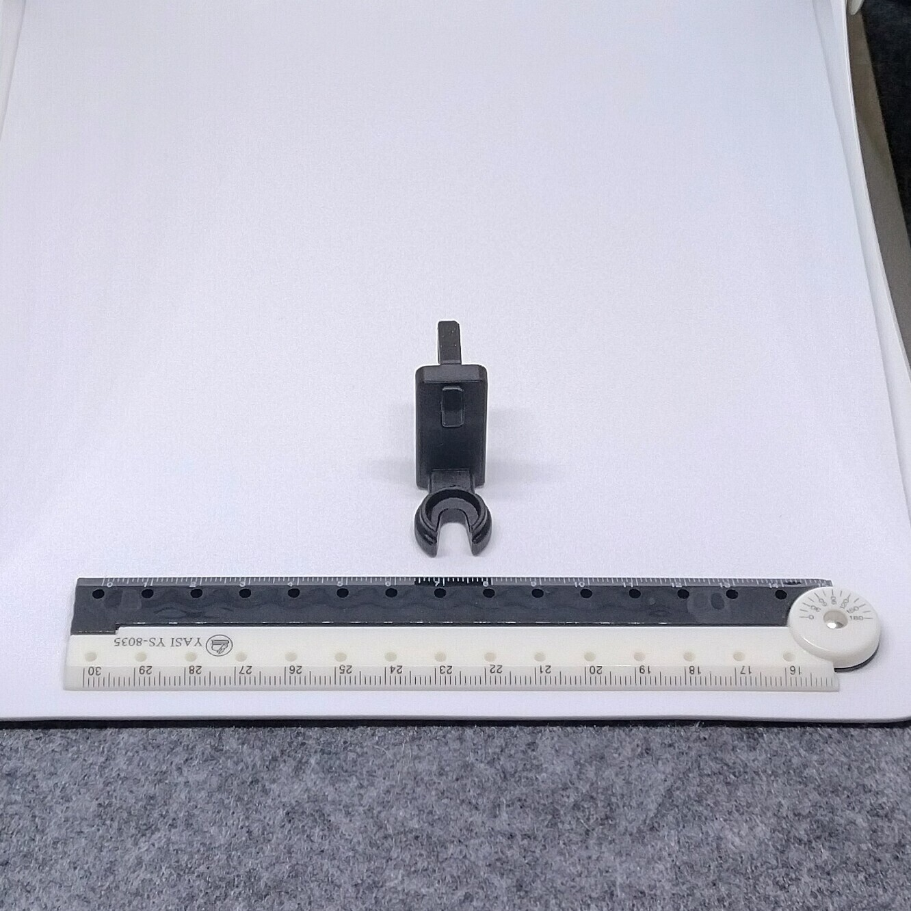
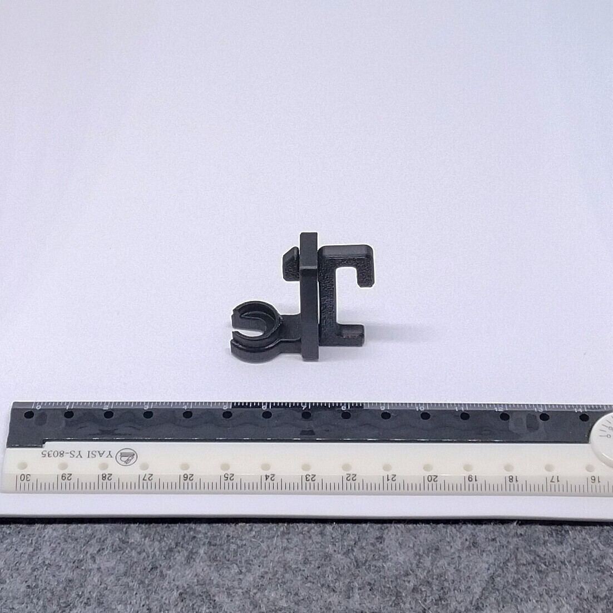

# Skadis - Desoldering pump (proxy)

- **Brief**: Skadis holder for a Pro'sKit 8PK-366N-G desoldering pump.
- **Tags**: `Skadis`, `desoldering pump`, `holder`

<!------------------------------------------------------------------------------------------------->
## Attribution
<!------------------------------------------------------------------------------------------------->

This entry references a 3D print model by **Oleksii Zelivianskyi** available at <https://www.printables.com/model/414157-ikea-skadis-desoldering-pump-holder>.

Explore my [3D print model collection](https://zeroexgit.github.io/3d-print-models/) to discover more models and check for updates to this one.

### Original Description

> This is Pro'sKit 8PK-366N-G desoldering pump holder for IKEA Skadis.
>
> This item is inspired by IKEA SKADIS Collection by CSD_Salzburg, it uses the same hook system (I included the hook).

<!------------------------------------------------------------------------------------------------->
## License
<!------------------------------------------------------------------------------------------------->

This model is licensed under [**CC BY-NC 4.0**](https://creativecommons.org/licenses/by-nc/4.0/).
