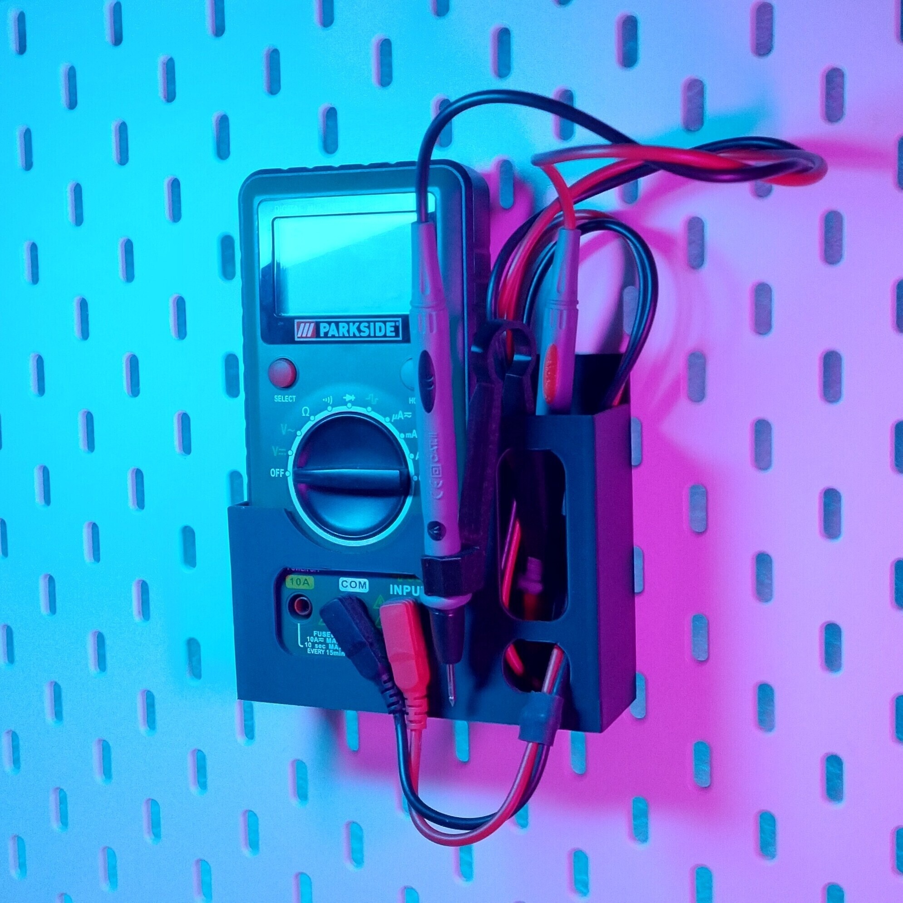
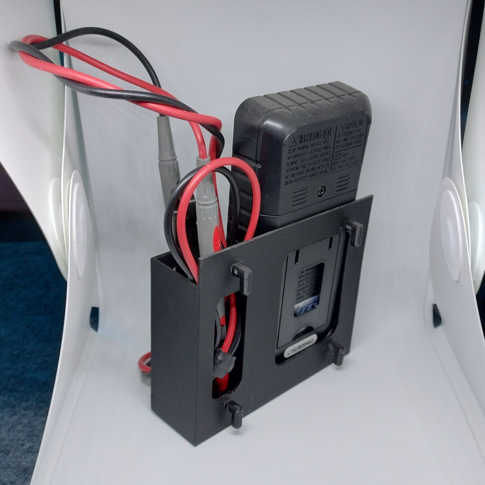

# Skadis - Parkside multimeter (proxy)

- **Brief**: Skadis-mounted holder for a Parkside multimeter, with a cable holder.
- **Tags**: `Skadis`, `multimeter`, `cable holder`

<!------------------------------------------------------------------------------------------------->
## Attribution
<!------------------------------------------------------------------------------------------------->

This entry references a 3D print model by **Ádám .Netuddmeg** available at <https://www.printables.com/model/465694-skadis-holder-for-parkside-multimeter>.

Explore my [3D print model collection](https://zeroexgit.github.io/3d-print-models/) to discover more models and check for updates to this one.

### Original Description

> I wanted to create a multimeter holder for my Skadis board in which all the buttons are still reachable because most of the time I only need for 1 or 2 quick measures. I also added a cable holder to the right so everything can be tucked away neatly.
>
> Use supports for the pegs at the back like in the picture shown (but only for the pegs, no other supports needed).

<!------------------------------------------------------------------------------------------------->
## License
<!------------------------------------------------------------------------------------------------->

This model is licensed under [**CC BY-NC 4.0**](https://creativecommons.org/licenses/by-nc/4.0/).
