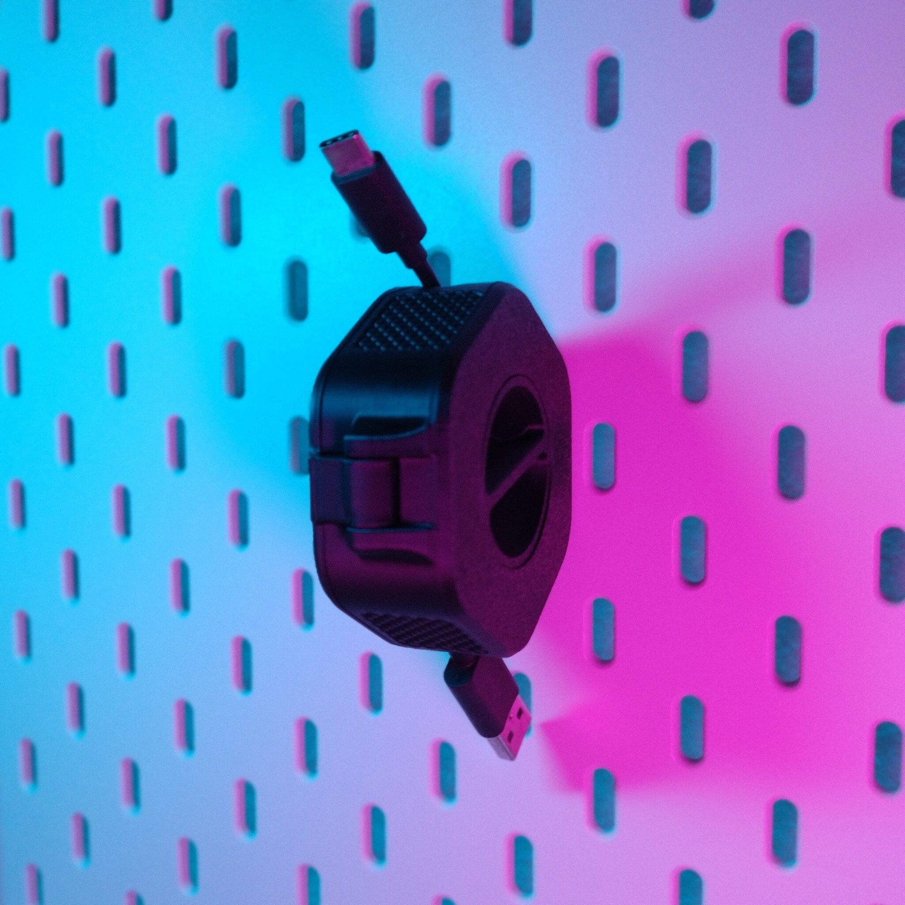
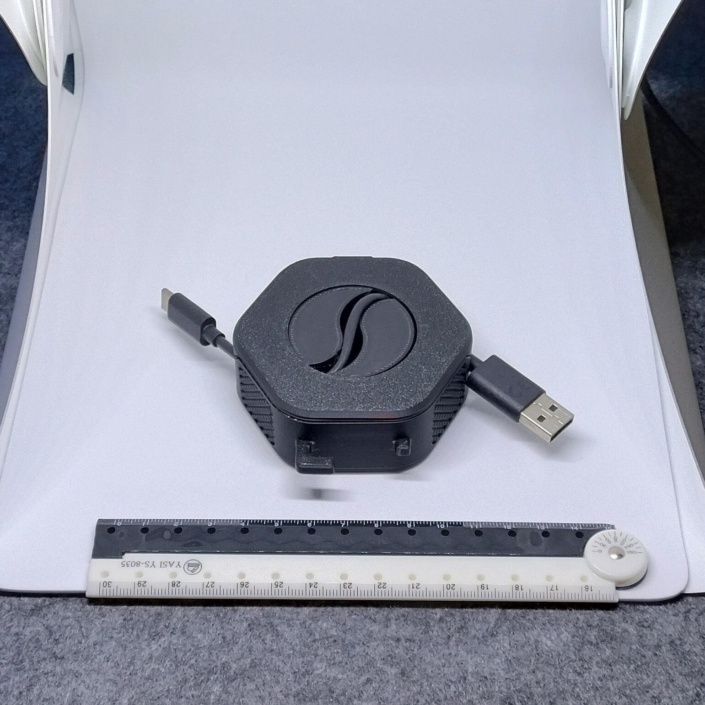
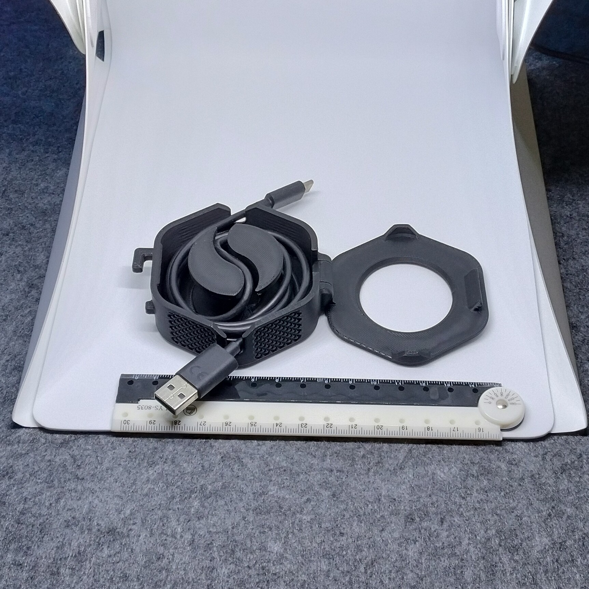

# Skadis - Portable cable winder (remix)

- **Brief**: Cable winder with a Skadis hook for hanging storage.
- **Tags**: `Skadis`, `cable organizer`, `cable winder`
- **Published**:
  [Thingiverse](https://www.thingiverse.com/thing:7424414),
  [Printables](https://www.printables.com/model/1883750-skadis-portable-cable-winder-remix),
  [MakerWorld](https://makerworld.com/en/models/3464400-skadis-portable-cable-winder-remix),
  [Cults3D](https://cults3d.com/en/3d-model/tool/skadis-portable-cable-winder-remix).

Hang several organizers side by side to keep different USB cable types easy to identify and reach. The winder can be used while hanging from the Skadis board.

This remix requires supports for printing. I chose this design to keep the winder centered and less likely to collide with nearby items. It uses minimal support material that is easy to remove.

<!------------------------------------------------------------------------------------------------->
## Attribution
<!------------------------------------------------------------------------------------------------->

This model is a remix of a 3D print model by **squinn** obtained from <https://www.printables.com/model/564262-portable-cable-organizer-winder>.

Explore my [3D print model collection](https://zeroexgit.github.io/3d-print-models/) to discover more models and check for updates to this one.

### Differences of the remix compared to the original

- Added a Skadis hook for hanging storage.

### Original Description

> A portable cable organizer which is setup as an easy print-in-place and includes a knob on the side for conveniently winding up the cable when you're ready to pack it away.
>
> This model is an easy print that requires no supports, and three different sizes are provided to accommodate cables of different lengths. If you're not sure which to choose, I'd recommend starting with the “medium” size.
>
> After printing, you'll want to place the cable within the groove at its halfway point, close the lid (which is intentionally designed to close tightly), wind up the cord clockwise using the handle, and then extend by simply grabbing the cable by both ends.

<!------------------------------------------------------------------------------------------------->
## License
<!------------------------------------------------------------------------------------------------->

This model is licensed under [**CC BY 4.0**](https://creativecommons.org/licenses/by/4.0/).
