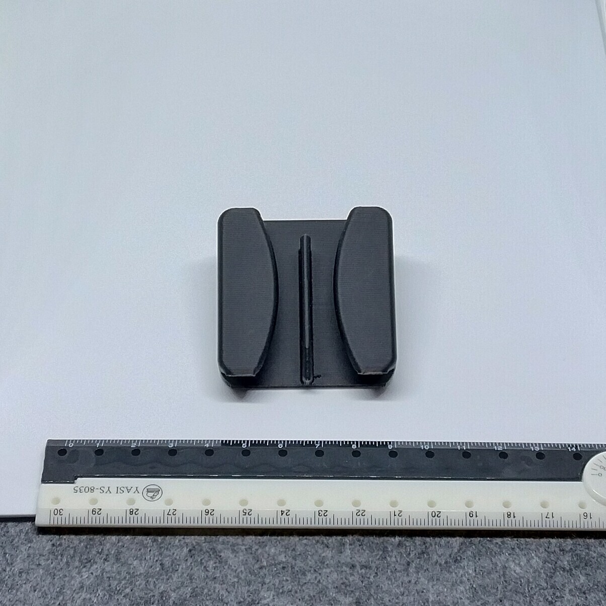
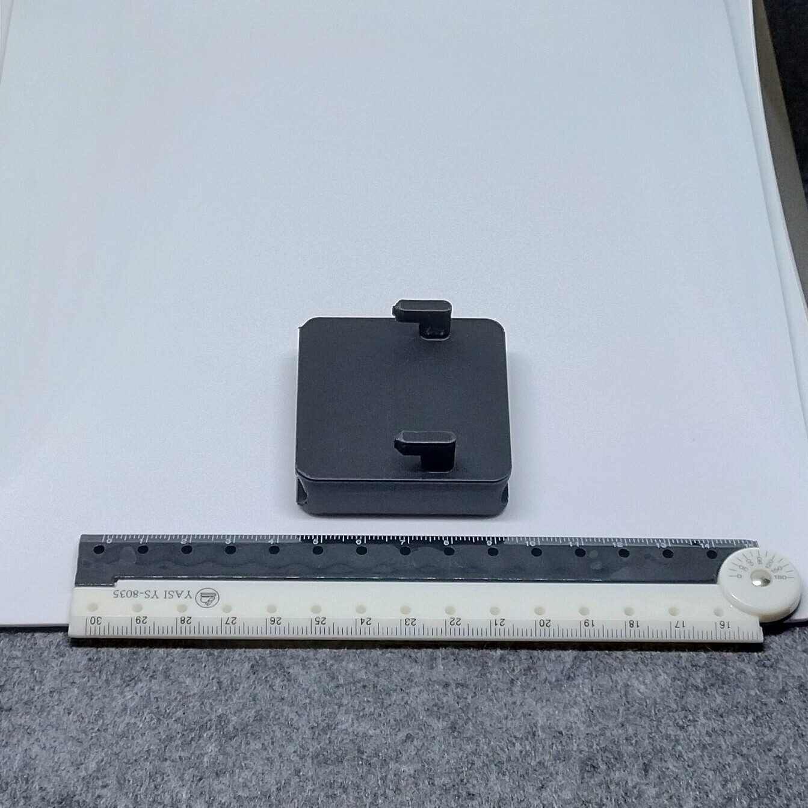

# Skadis - Quick-access cable holder (proxy)

- **Brief**: Wall-mounted cable holder for organizing and securing USB and charging cables.
- **Tags**: `Skadis`, `cable holder`, `cable management`

<!------------------------------------------------------------------------------------------------->
## Attribution
<!------------------------------------------------------------------------------------------------->

This entry references a 3D print model by **Handy Handcrafts** available at <https://www.printables.com/model/718155-new-improved-skadis-cable-holder>.

Explore my [3D print model collection](https://zeroexgit.github.io/3d-print-models/) to discover more models and check for updates to this one.

### Original Description

> Here's my wire and cable holder, specifically designed for the Skadis storage system. This innovative holder is designed to fit into your Skadis board, providing an elegant and practical solution for cable management. Its design is tailored to neatly organize and secure a variety of USB cables and charging wires, ensuring a tidy and clutter-free workspace. It's the perfect choice for anyone looking to declutter their office or workspace, offering a simple yet effective way to keep unruly cables wrangled and tamed."

<!------------------------------------------------------------------------------------------------->
## License
<!------------------------------------------------------------------------------------------------->

This model is licensed under [**CC BY-NC 4.0**](https://creativecommons.org/licenses/by-nc/4.0/).
