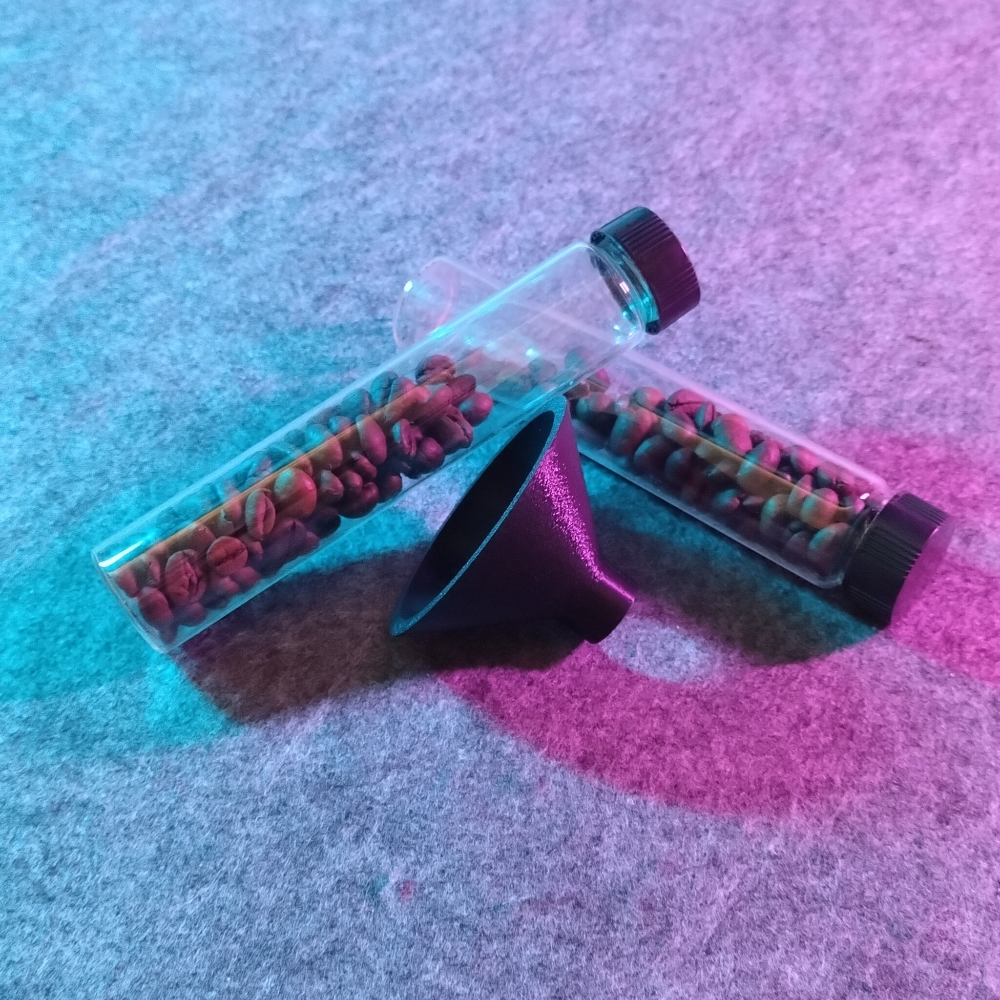
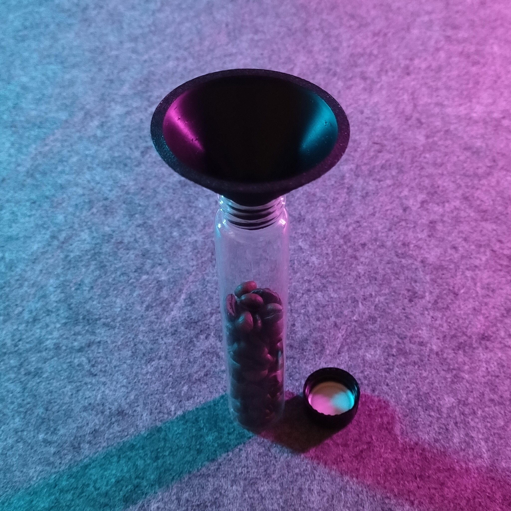
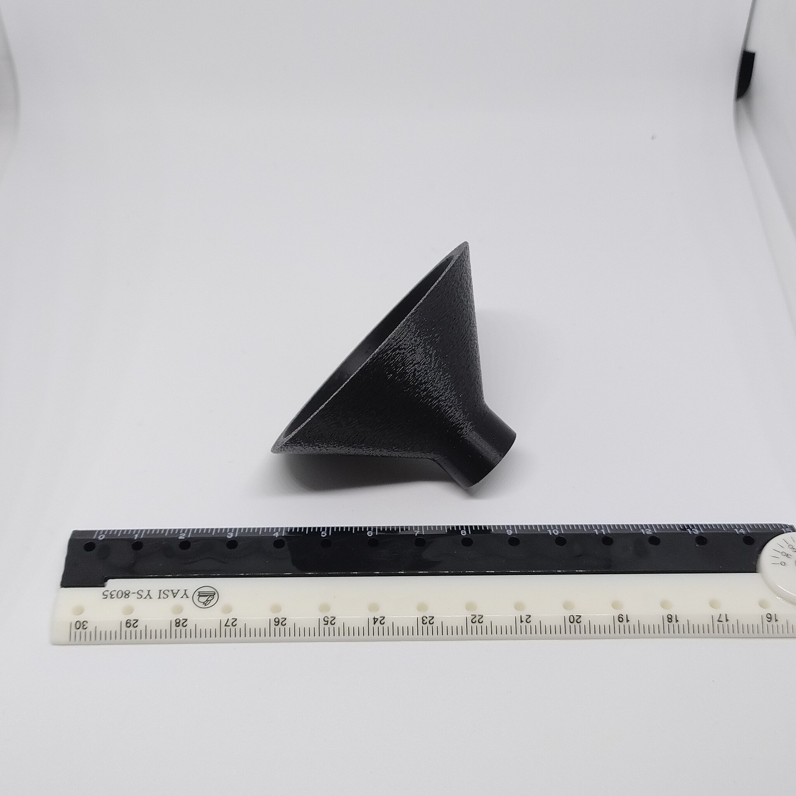
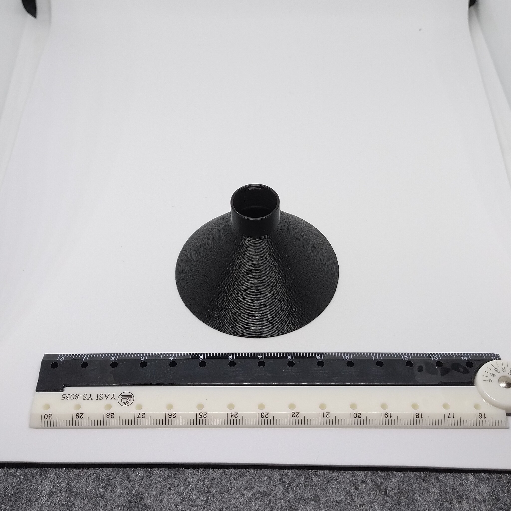

# Funnel for 27 mm OD vials with 18 mm opening

- **Brief**: Simple funnel for filling 27 mm outer-diameter glass vials with an 18 mm opening.
- **Tags**: `funnel`, `coffee`, `glass vial`, `test tube`.
- **Published**:
  [Thingiverse](https://www.thingiverse.com/thing:7425513),
  [Printables](https://www.printables.com/model/1886780-funnel-for-27-mm-od-vials-with-18-mm-opening),
  [MakerWorld](https://makerworld.com/en/models/3477331-funnel-for-27-mm-od-vials-with-18-mm-opening),
  [Cults3D](https://cults3d.com/en/3d-model/tool/funnel-for-27-mm-od-vials-with-18-mm-opening-zeroex).

I use this funnel to refill coffee beans into the 27 mm glass vials used with my [Gridfinity - Bin 2.4.6 - Coffee bean test tube holder (remix)](../../gridfinity/Gridfinity%20-%20Bin%202.4.6%20-%20Coffee%20bean%20test%20tube%20holder%20%28remix%29/README.md).

<!------------------------------------------------------------------------------------------------->
## Attribution
<!------------------------------------------------------------------------------------------------->

This is an original 3D print model.

Explore my [3D print model collection](https://zeroexgit.github.io/3d-print-models/) to discover more models and check for updates to this one.

<!------------------------------------------------------------------------------------------------->
## License
<!------------------------------------------------------------------------------------------------->

This model is licensed under [**CC BY-NC-SA 4.0**](https://creativecommons.org/licenses/by-nc-sa/4.0/).
